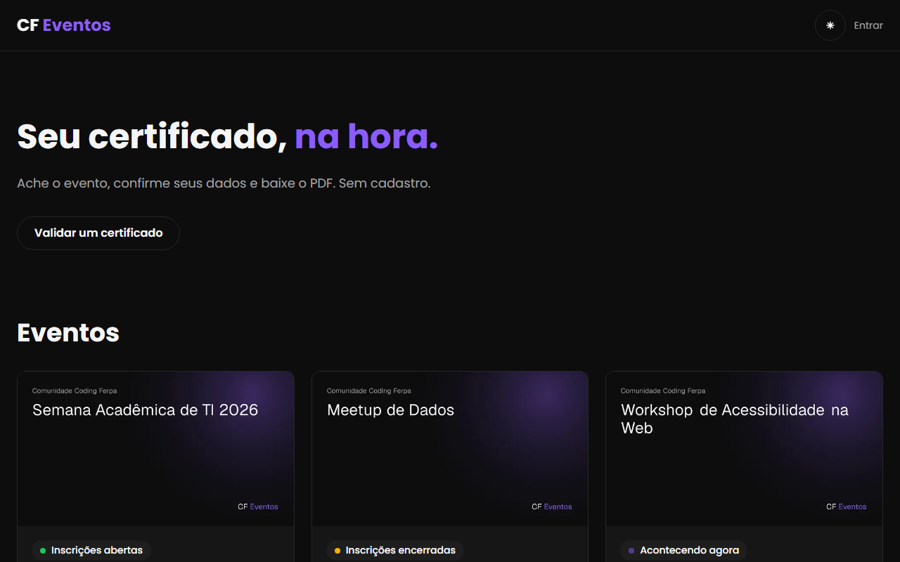
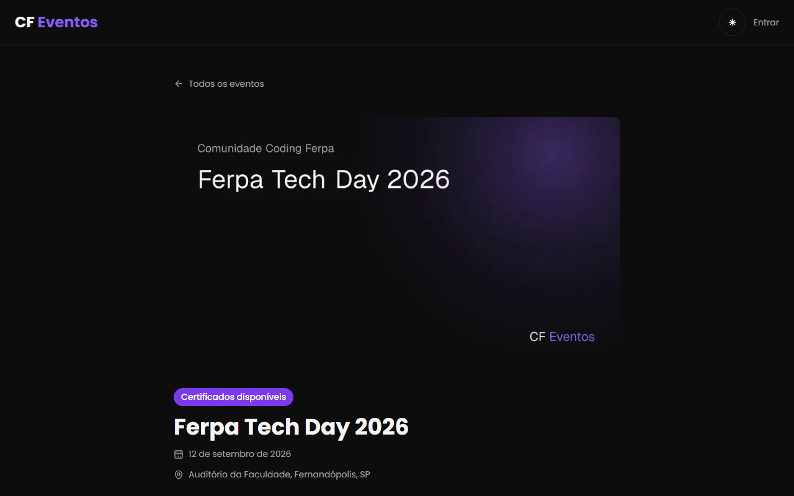
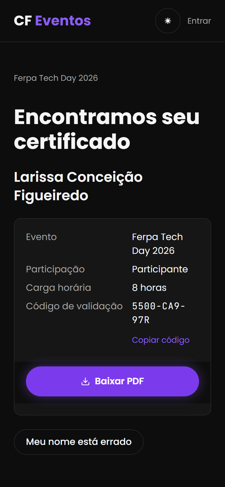
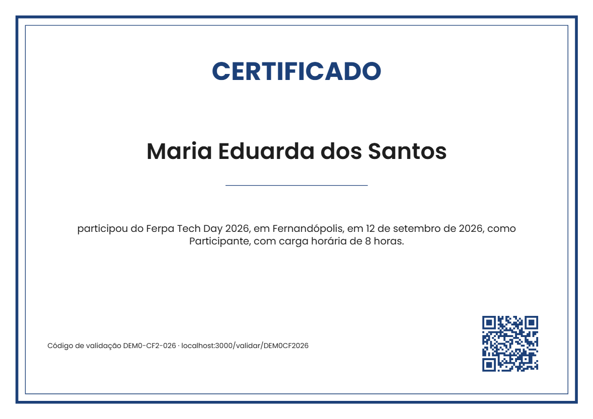
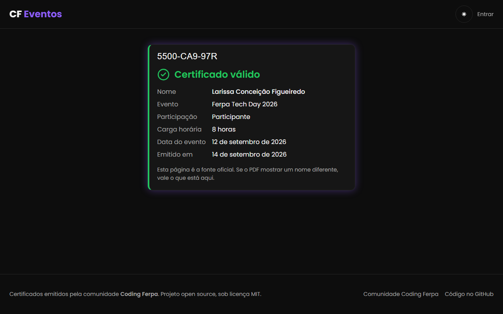
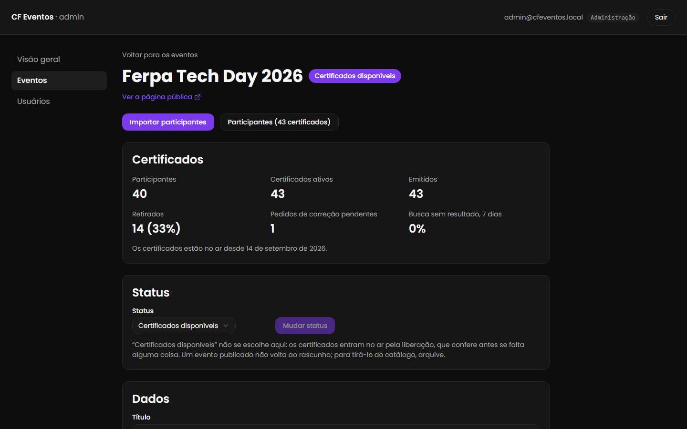
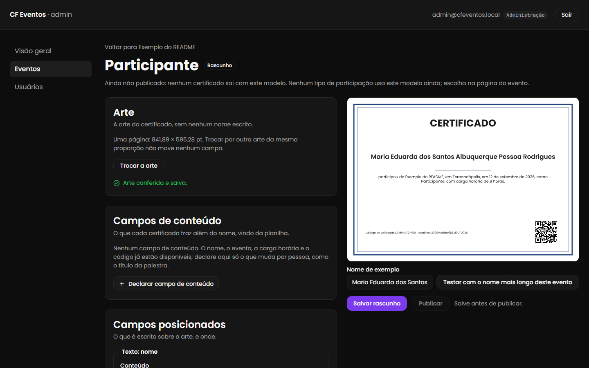
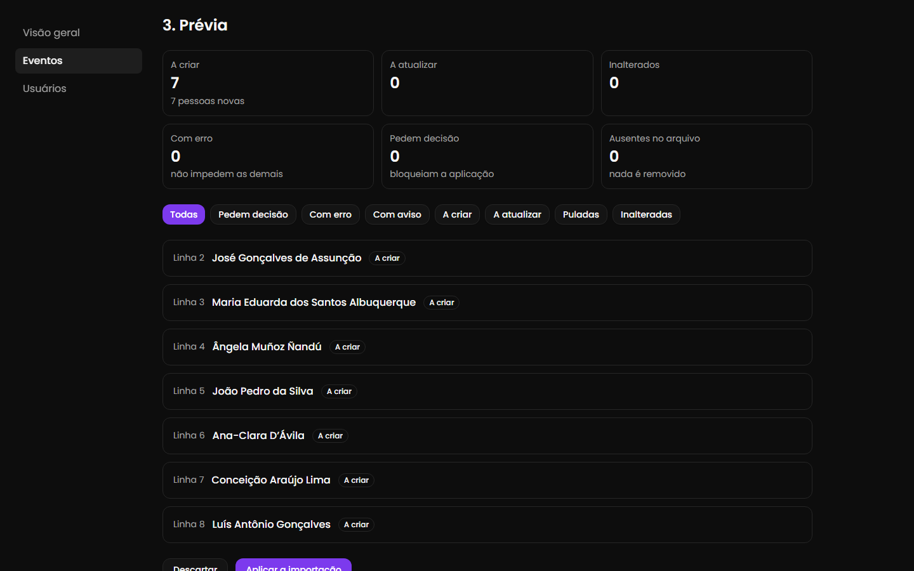

# CF Eventos

Plataforma de certificados dos eventos da comunidade **Coding Ferpa**
(Fernandópolis/SP). A organização cadastra o evento, sobe a arte do
certificado, posiciona os campos sobre ela e importa a lista de participantes
por CSV. O aluno acha o certificado sem cadastro, confere o nome na prévia e
baixa o PDF gerado na hora, com QR que leva a uma página pública de validação.

`eventos.codingferpa.org` · licença MIT · segundo projeto da casa, depois do
[CF Jobs](https://github.com/Coding-Ferpa/cf-jobs).

> **Em produção.** A fase 1 do [PRD](docs/spec-produto.md) está completa e no
> ar desde novembro de 2026. O primeiro evento atendido foi o Ferpa Tech Day
> 2026: 102 certificados para 54 participantes, o do evento e o de cada oficina.
> O que vem depois está no [roteiro](docs/13-roadmap.md).

## O que faz

**Para quem participou**

- Busca o certificado sem cadastro, pelo que o evento escolher: CPF, e-mail ou
  nome completo, com limite de tentativas contra varredura.
- Confere os dados na tela e baixa o PDF, gerado na hora, com código e QR de
  validação.
- Recebe mais de um certificado no mesmo evento, um por tipo de participação:
  o do evento e o da oficina, por exemplo, cada um com a sua arte.
- Valida qualquer certificado em `/validar/<código>`, que mostra os dados
  atuais e avisa quando foi revogado.
- Pede a correção do nome pela própria tela, sem sair da plataforma.

**Para a organização**

- Cadastra eventos, capa, tipos de participação com carga horária e as chaves
  da busca.
- Monta o modelo sobre a arte em PDF: nome, código, QR e textos com dados do
  evento, posicionados por número, com prévia ao vivo e o teste do nome mais
  longo.
- Importa a planilha como ela vem do Excel em português: acha a codificação e o
  separador, sugere o que é cada coluna e mostra o que vai mudar antes de
  aplicar. Reconhece a mesma pessoa entre importações, então o certificado da
  oficina cai na pessoa que já tinha o do evento.
- Libera os certificados depois de conferir o que falta, e revoga ou restaura
  quando precisa.
- Trabalha com três papéis: admin, editor e leitor.

**Privacidade (LGPD):** o CPF nunca fica gravado em claro, só um HMAC; os logs
não guardam nome, e-mail nem CPF; e a eliminação a pedido da pessoa é a função
`erase_participant` do banco, que apaga tudo o que a reconhece
([doc 08](docs/08-seguranca-e-lgpd.md)).

## Telas

Capturas do ambiente local no tema escuro, com os dados fictícios do seed. O certificado é o PDF em si, por isso continua claro.

| Catálogo                                             | Página do evento, com a busca                   |
| ---------------------------------------------------- | ----------------------------------------------- |
|  |  |

| Retirada no celular                                                                            | Certificado gerado                                                |
| ---------------------------------------------------------------------------------------------- | ----------------------------------------------------------------- |
|  |  |

| Validação pública                                     | Evento no admin                                                |
| ----------------------------------------------------- | -------------------------------------------------------------- |
|  |  |

| Editor de modelo, com a prévia ao vivo                    | Prévia da importação, antes de aplicar                  |
| --------------------------------------------------------- | ------------------------------------------------------- |
|  |  |

O certificado de exemplo sai da rota `/api/dev/certificado-exemplo`, que só
existe fora da produção; por isso o endereço de validação nele é o local.

## Documentação

A arquitetura é canônica: nenhuma decisão de implementação a contradiz sem um
ADR aprovado. Comece pelo [índice](docs/README.md). Quem quer entender o
sistema em meia hora lê a [visão geral](docs/00-visao-geral.md), a
[arquitetura](docs/02-arquitetura.md) e o
[motor de certificados](docs/05-motor-de-certificados.md).

O documento de produto é o [PRD](docs/spec-produto.md). A operação (ida ao ar,
primeiro admin, primeiro evento) está no [runbook](docs/runbooks.md).

## Stack

Next.js 16 (App Router, RSC) · TypeScript strict · Tailwind CSS v4 ·
shadcn/ui · Drizzle ORM · Supabase (Postgres, Auth, Storage) · Zod 4 ·
pnpm 11 · Node 26 LTS · Vitest, Testing Library, Playwright e pgTAP · deploy
na Vercel. O porquê de cada escolha, e de cada dependência nova, está no
[doc 01](docs/01-stack.md).

Os testes cobrem quatro camadas: unidade, integração com o banco, o próprio
banco (pgTAP, com a matriz de RLS) e ponta a ponta em quatro navegadores
(Chrome e Safari, no desktop e no celular).

## Rodando localmente

Pré-requisitos: Node 26 LTS (há um `.nvmrc`), pnpm 11, Git e Docker.

```bash
git clone git@github.com:Coding-Ferpa/eventos.git && cd eventos
pnpm install
cp .env.example .env
pnpm db:start   # Supabase local, com as migrations e os seeds pelo db:migrar
pnpm db:reset   # o banco local do zero: migrations e os dois seeds
pnpm dev
```

Os valores do `.env` saem de `pnpm db:status` (URL da API, chave anônima,
chave de serviço e URL do banco); cada variável está comentada no
`.env.example`, e os segredos do cookie de dispositivo já vêm com valor de
desenvolvimento.

O Supabase local deste projeto usa portas deslocadas em +100 (API em 54421,
banco em 54422, Studio em 54423, e-mails de teste em 54424), para conviver
com o do CF Jobs na mesma máquina. O seed de desenvolvimento cria três contas
com a senha `cfeventos-local`, que só existe localmente: `admin@cfeventos.local`,
`editor@cfeventos.local` e `reader@cfeventos.local`, esta sem acesso ao
painel, como todo cadastro novo.

## Produção

- **Aplicação:** Vercel, na região `gru1`. Cada push na `main` vira deploy de
  produção.
- **Banco:** o projeto Supabase do CF Jobs, com o Eventos inteiro no schema
  `eventos`, sem tocar no `public` ([ADR-0018](docs/adr/0018-schema-proprio-no-projeto-do-cf-jobs.md)).
  O papel de cada pessoa vem de `eventos.profiles`, e não do token.
- **Migrations:** só pelo `pnpm db:migrar`. Com `--remote` ele mostra o plano;
  com `--remote --yes`, aplica. **Nunca rode `supabase db push` neste
  repositório:** o histórico de migrations da CLI é do CF Jobs.

O passo a passo, com os caminhos exatos nos painéis, está no
[runbook](docs/runbooks.md).

## Scripts

| Comando                                             | O que faz                                                   |
| --------------------------------------------------- | ----------------------------------------------------------- |
| `pnpm dev`                                          | servidor de desenvolvimento                                 |
| `pnpm build`                                        | build de produção                                           |
| `pnpm lint` · `pnpm typecheck`                      | ESLint e TypeScript                                         |
| `pnpm format` · `pnpm format:check`                 | Prettier                                                    |
| `pnpm test` · `pnpm test:coverage`                  | Vitest                                                      |
| `pnpm test:e2e`                                     | Playwright                                                  |
| `pnpm check:env`                                    | confere `.env.example` contra o schema de env               |
| `pnpm db:start` · `pnpm db:stop` · `pnpm db:status` | Supabase local                                              |
| `pnpm db:reset`                                     | aplica as migrations do zero e os seeds                     |
| `pnpm db:migrar`                                    | migrations pendentes; `--remote` mostra o plano de produção |
| `pnpm db:test`                                      | pgTAP: matriz de RLS, funções e guardas                     |
| `pnpm check:schema`                                 | confere o schema Drizzle contra o banco, nas duas direções  |
| `pnpm check:migrations`                             | gate de expand/contract nas migrations                      |

## Próximos passos

Com a fase 1 no ar, os próximos milestones são entregues em produção, por PR
([doc 13](docs/13-roadmap.md)):

- **M10:** arrastar e redimensionar os campos sobre a prévia do modelo.
- **M11:** aviso por e-mail de que os certificados estão prontos, com link
  direto (Resend, disparo sempre pelo admin), fila de correção de nome, "Meus
  certificados" por CPF e clonar evento.
- **M12:** painel com as métricas do evento, exportações e o botão de
  adicionar ao LinkedIn.

## Contribuindo

Leia o [guia de contribuição](CONTRIBUTING.md) e o
[Código de Conduta](CODE_OF_CONDUCT.md). Vulnerabilidade tem canal próprio, e
nunca é issue pública: veja a [política de segurança](SECURITY.md).

Uma regra vale para qualquer contribuição: **nenhum dado real de participante
entra no repositório**, nem em fixture, issue, screenshot ou log colado.
