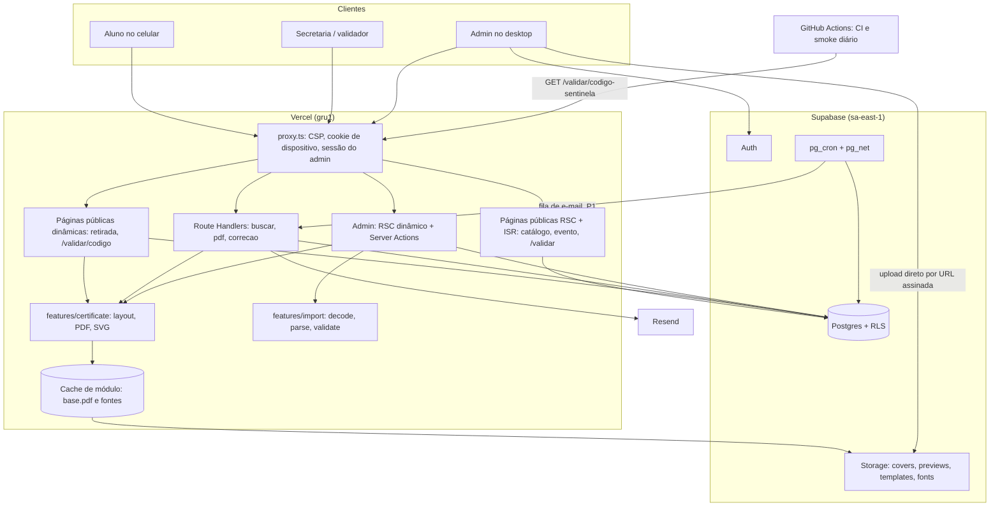
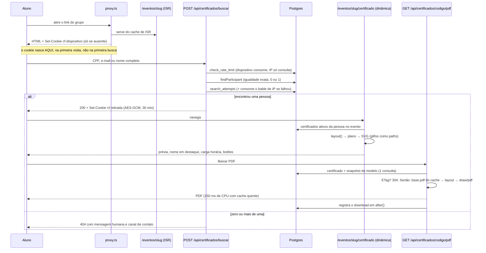
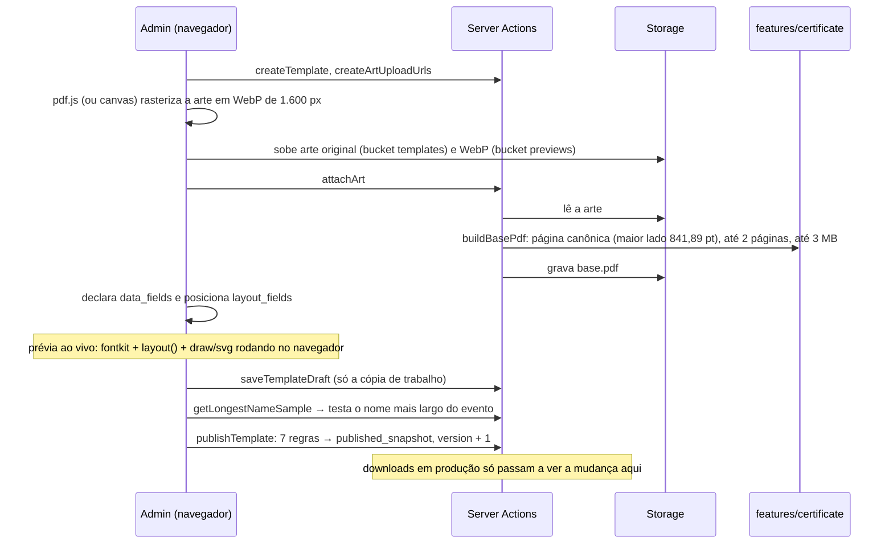

# 02 · Arquitetura do sistema

## Visão de componentes



Um único app Next.js, um único projeto Supabase, um único `pnpm dev`. Não há worker, fila externa, Redis nem serviço de PDF separado. A mesma topologia do CF Jobs, pelos mesmos motivos: custo zero, um pipeline de deploy, onboarding de contribuidor em minutos.

Duas coisas que o diagrama torna visíveis e que são decisões, não acidentes:

- **O navegador do admin sobe a arte direto para o Storage.** O corpo de requisição de uma Vercel Function é limitado a 4,5 MB e uma arte de certificado passa disso. O servidor só emite a URL assinada e depois lê o arquivo do bucket.
- **O motor roda em dois lugares.** No servidor (download e prévia da tela de retirada) e no navegador do admin (prévia instantânea do editor). É o mesmo código, porque `features/certificate` é puro e isomórfico.

## Os três fluxos centrais

### 1. Retirada do certificado (o caminho do aluno)



Meta do PRD: menos de 1 minuto, sem cadastro. O desenho entrega isso com duas requisições dinâmicas além do download, nenhuma biblioteca pesada no celular (a prévia é SVG inline) e nenhuma etapa que dependa de e-mail.

### 2. Importação de CSV (o caminho do admin às 23h)

```mermaid
sequenceDiagram
    participant AD as Admin
    participant SA as Server Actions
    participant F as features/import (puro)
    participant DB as Postgres

    AD->>SA: inspectCsv(arquivo, "esta lista é de: Participantes")
    SA->>F: decode (BOM → UTF-8 estrito → Windows-1252), parse, cabeçalhos
    SA-->>AD: encoding, delimitador, 10 linhas já decodificadas, sugestão de mapeamento
    Note over SA: nada foi gravado. O arquivo morreu na memória.
    AD->>SA: stageImport(arquivo de novo, mapeamento)
    SA->>F: valida cada linha contra o modelo DO TIPO daquela linha; CPF vira HMAC aqui
    SA->>DB: import_batches + import_rows (sem CPF em claro)
    SA->>DB: compute_import_diff(batch): cascata de conciliação em SQL
    SA-->>AD: prévia: criar, atualizar, inalterados, erros por linha, decisões, preview_digest
    AD->>SA: applyImport(batch, preview_digest)
    SA->>DB: apply_import(): advisory lock do evento → recalcula o diff → digest confere?
    alt confere
        DB->>DB: insere e atualiza tudo em UMA transação (códigos, sequência, versões)
        SA-->>AD: aplicado: N criados, N atualizados
    else a lista mudou desde a prévia
        SA-->>AD: preview_stale + prévia nova. Nada foi escrito.
    end
```

Detalhe completo no [doc 06](06-importacao-csv.md).

### 3. Criação de modelo de certificado



Formulário (M6) e arrastar (M10) produzem **a mesma estrutura** (`layout_fields` com caixas de 0 a 1). O motor não sabe qual dos dois gerou os números.

## Camadas e regras de dependência

```
app/ (rotas, RSC, Route Handlers)  →  actions/  →  features/, db/queries  →  db/schema, lib/
components/                        →  lib/, features/*/ (só tipos e funções puras)
features/certificate, features/import  →  nada de next/*, nada de db/, nada de lib/supabase
```

- Componentes nunca acessam o banco: recebem dados por props.
- Server Actions são a única porta de escrita do admin, sempre via `defineAction` ([doc 07](07-apis-e-actions.md)).
- `db/queries/public-lookup.ts` é o **único** módulo que lê pessoa para o público, e só pode ser importado pelas rotas listadas no [doc 08](08-seguranca-e-lgpd.md). Imposto por lint.
- `features/certificate` e `features/import` são lógica pura: recebem bytes e dados, devolvem bytes e dados. Isolamento de Clean Architecture aplicado **só aqui**, onde há lógica de domínio real e TDD obrigatório. O CRUD do admin não ganha camada hexagonal nenhuma.
- Quem busca bytes (disco, Storage) e mantém cache é `lib/certificate-assets.ts`, fora do módulo puro.

## Estrutura de pastas

```
cf-eventos/
├── docs/                              # esta documentação
│   └── adr/
├── public/
│   └── fonts/cert/                    # TTF estáticos das 5 famílias curadas + LICENSES/
├── scripts/                           # check-env, check-schema, check-migrations, check-fonts,
│                                      # anonymize-csv, load-test-download
├── src/
│   ├── app/
│   │   ├── (public)/
│   │   │   ├── page.tsx                           # catálogo (ISR)
│   │   │   ├── eventos/[slug]/page.tsx            # evento (ISR) + bloco de ação por status
│   │   │   ├── eventos/[slug]/opengraph-image.tsx
│   │   │   ├── eventos/[slug]/capa/route.tsx      # capa gerada quando cover_path é null
│   │   │   ├── eventos/[slug]/certificado/page.tsx   # tela de retirada (dinâmica, cookie)
│   │   │   ├── validar/page.tsx                   # formulário (estática)
│   │   │   ├── validar/[codigo]/page.tsx          # resultado (dinâmica, nunca em cache)
│   │   │   ├── certificado/[token]/route.ts       # P1: troca token por cookie
│   │   │   ├── meus-certificados/                 # P1
│   │   │   ├── privacidade/page.tsx
│   │   │   ├── sitemap.ts
│   │   │   └── robots.ts
│   │   ├── (auth)/login/page.tsx
│   │   ├── admin/
│   │   │   ├── layout.tsx                         # guard de papel, force-dynamic
│   │   │   ├── page.tsx                           # visão geral (dashboard completo no M12)
│   │   │   ├── eventos/                           # lista, novo, [id]/ (dados, tipos, busca, liberar)
│   │   │   ├── eventos/[id]/modelos/[templateId]/ # editor: arte, campos de conteúdo, layout, prévia
│   │   │   ├── eventos/[id]/importar/             # assistente de 4 passos
│   │   │   ├── eventos/[id]/participantes/        # lista filtrável por lote, edição, remoção, revogação
│   │   │   ├── eventos/[id]/exportar/             # P1: route handlers xlsx e pdf
│   │   │   ├── correcoes/                         # P1: fila
│   │   │   ├── envios/                            # P1: campanhas de e-mail
│   │   │   ├── fontes/
│   │   │   └── usuarios/
│   │   └── api/
│   │       ├── certificados/buscar/route.ts
│   │       ├── certificados/[codigo]/pdf/route.ts
│   │       ├── certificados/[codigo]/correcao/route.ts
│   │       ├── eventos/[slug]/visita/route.ts
│   │       ├── meus-certificados/buscar/route.ts  # P1
│   │       ├── internal/revalidate/route.ts
│   │       ├── internal/email/dispatch/route.ts   # P1
│   │       ├── webhooks/resend/route.ts           # P1
│   │       └── dev/certificado-exemplo/route.ts   # fora de produção
│   ├── actions/                       # define-action, authorize, result + um arquivo por domínio
│   ├── components/
│   │   ├── ui/                        # shadcn/ui
│   │   ├── layout/                    # header, footer, theme-toggle, theme-script
│   │   ├── eventos/                   # event-card, status-badge, search-form, in-app-browser-hint
│   │   ├── certificado/               # certificate-preview (SVG), retrieval-card, correction-form
│   │   ├── validacao/                 # code-input, validation-result
│   │   └── admin/                     # template-editor/, import-wizard/, data-table...
│   ├── db/
│   │   ├── schema/                    # Drizzle, um arquivo por domínio
│   │   ├── queries/                   # events, templates, participants, imports, stats,
│   │   │                              # rate-limit, public-lookup
│   │   └── client.ts                  # db + queryAsAnon (herdado)
│   ├── features/
│   │   ├── certificate/               # doc 05
│   │   └── import/                    # doc 06: decode, parse, mapping, validate-row, cpf
│   ├── lib/                           # env, zod, auth, roles, schemas/, format, slug, seo,
│   │                                  # security-headers, theme, cookies (device, retrieval),
│   │                                  # hmac (cpf, ip, device), certificate-assets, email/, supabase/
│   └── proxy.ts
├── supabase/
│   ├── migrations/                    # doc 04, RLS junto de cada tabela
│   ├── seeds/                         # 01-producao (só o sentinela), 02-dev (sintético)
│   ├── tests/                         # pgTAP
│   └── config.toml
├── tests/
│   └── fixtures/                      # csv/ (binário exato, -text no .gitattributes), certificate/
├── e2e/
└── (configs na raiz: ver doc 12)
```

Convenção de nomes: arquivos em `kebab-case`; inglês para conceito técnico (`fit-text.ts`, `public-lookup.ts`), português para conceito de domínio e para rotas (`/validar`, `eventos/`, `certificado/`). Banco em inglês.

## Decisões transversais

| Tema | Decisão |
|---|---|
| Região | Funções Vercel em `gru1`, Supabase em `sa-east-1`. Fixado no `vercel.json` e no runbook. |
| Runtime | Node em tudo que toca banco, PDF ou criptografia. Node 24.x fixado no projeto da Vercel. |
| Timezone | UTC no banco, exibição em `America/Sao_Paulo`. A data impressa no certificado é calculada nesse fuso. |
| Slug de evento | `kebab-case` do título, editável só em `draft`. Depois de publicado é imutável: está em QR de cartaz e em link de grupo. |
| Mensagens de validação | `z.config(z.locales.pt())` em `lib/zod.ts`, que reexporta o `z` (ADR-0016 do CF Jobs). Todo import de Zod vem de `@/lib/zod`. |
| Erros | `error.tsx` por segmento, linguagem humana. Falha do PDF nunca mostra stack: redireciona para a tela de retirada com alerta. |
| Status do evento | Manual. Nenhuma transição automática por data: quem decide que os certificados estão no ar é uma pessoa, em um clique (`releaseCertificates`). |
| Evento arquivado | Some do catálogo e desliga a busca. Links diretos por e-mail e a validação continuam funcionando. |
| Navegador embutido | Na página do evento, detecção por user agent de Instagram e Facebook in-app mostra, **antes** da busca, a dica "abra no Chrome ou Safari para baixar o PDF" (download em webview é instável, e trocar de navegador depois da busca perderia o cookie). |
| Tema | Script inline antes da primeira pintura, cookie `cf-tema`, nunca `cookies()` no layout ([doc 03](03-design-system.md)). |
| Feature flags | Não. Fases entram por PR. |
| Ambientes | Produção e local (Supabase CLI). O plano gratuito do Supabase comporta 2 projetos e eles já estão ocupados (CF Jobs e CF Eventos), então **não há staging com banco**. Previews da Vercel sobem sem env de banco: servem para revisar UI estática e para a rota `/api/dev/certificado-exemplo`. O que precisa de banco é testado localmente e no CI. |
| Teste de carga | Feito contra produção, com o certificado sentinela do seed, antes do anúncio do primeiro evento ([doc 11](11-qualidade.md)). |
