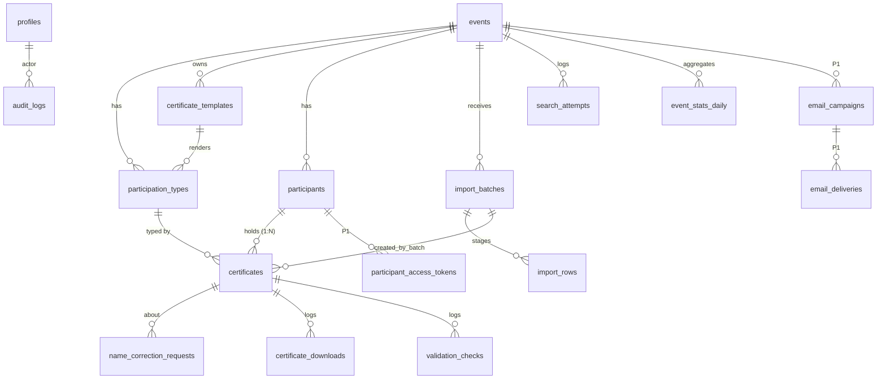

# 04 · Banco de dados (Supabase Postgres)

## Princípios de modelagem

1. **Pessoa e documento são coisas diferentes.** `participants` guarda quem a pessoa é (identidade). `certificates` guarda o que aquele documento afirma (tipo de participação, carga horária, conteúdo dinâmico, código, versão). Uma pessoa pode ser palestrante e organizadora no mesmo evento, com carga horária e título de palestra distintos: são dois certificados de um participante ([ADR-0004](adr/0004-payload-dinamico-no-certificado.md)).
2. **Identidade tem schema fixo, conteúdo é dinâmico.** Os únicos campos de identidade são `full_name`, `cpf_hash`, `cpf_last3`, `birth_date` e `email`, em colunas reais. São os únicos usados na busca pública e na conciliação da importação, e o admin não pode criar outros. Todo o resto que o certificado imprime (`titulo_palestra`, `turma`, `orientador`) é declarado pelo modelo e gravado em `certificates.data` (JSONB).
3. **Carga horária é coluna, não conteúdo.** `certificates.hours` é de primeira classe porque a página de validação, o JSON-LD, o LinkedIn e o dashboard dependem dela. Um campo livre não serve de contrato.
4. **CPF nunca existe em claro.** Nem em tabela, nem em staging, nem em log. Só `cpf_hash` (HMAC, [doc 08](08-seguranca-e-lgpd.md)) e `cpf_last3`.
5. **Enums de sistema em inglês, rótulos em pt-BR na aplicação.** O PRD nomeia os estados em português; o banco segue a convenção da casa. O mapeamento está na seção de enums.
6. **Nada de delete físico para o que já circulou.** Certificado emitido é revogado ou vira lápide (`erased`), nunca some: o código impresso em um papel precisa continuar respondendo algo honesto.
7. **Normalização de nome mora no banco.** Uma função SQL imutável é a única fonte de verdade; coluna gerada em `participants` e em `import_rows`, e a busca normaliza a entrada chamando a mesma função. Zero chance de o TypeScript e o SQL divergirem.
8. **Todo dado de observabilidade nasce no banco**, como no CF Jobs. O dashboard não depende de ferramenta externa.

## ERD



## Extensões

`pgcrypto` (bytes aleatórios do código de validação), `pg_trgm` (similaridade de nomes, só no admin), `pg_cron`, `pg_net`, `supabase_vault` (segredo do cron, herdado do ADR-0018 do CF Jobs), `pgtap` (testes). A `0001` cria só as três primeiras: `pg_net` e o Vault chegam no M11, com o despacho da fila de e-mail, que é a primeira vez que o banco chama a aplicação; `pgtap` é criada pelos próprios arquivos de teste. `unaccent` **não** é usada: ela é `STABLE`, não serve em coluna gerada sem wrapper, e o mapa explícito de `translate` abaixo é imutável de verdade e legível.

## Enums

| Enum | Valores | Rótulo pt-BR (PRD) |
|---|---|---|
| `user_role` | `admin`, `editor`, `reader` | `reader` é o papel de quem acabou de se cadastrar: não acessa nada. Existe porque o GitHub OAuth é aberto. |
| `event_status` | `draft`, `registration_open`, `registration_closed`, `in_progress`, `completed`, `certificates_available`, `archived` | `rascunho`, `inscricoes_abertas`, `inscricoes_encerradas`, `em_andamento`, `realizado`, `certificados_disponiveis`, `arquivado` |
| `search_mode` | `any`, `all` | "qualquer um", "todos" |
| `template_status` | `draft`, `published` | |
| `art_kind` | `pdf`, `image` | |
| `certificate_status` | `active`, `revoked`, `erased` | válido, revogado, removido a pedido do titular |
| `import_status` | `staged`, `applied`, `discarded`, `failed`, `expired` | [doc 06](06-importacao-csv.md) |
| `import_row_action` | `create`, `update`, `unchanged`, `error`, `needs_decision`, `skipped` | |
| `correction_status` | `pending`, `approved`, `rejected` | |
| `search_method` | `cpf`, `email`, `name`, `all`, `token`, `my_certificates` | |
| `search_outcome` | `found`, `not_found`, `ambiguous`, `rate_limited`, `event_unavailable` | `ambiguous` só existe no log: para fora é igual a `not_found` |
| `download_source` | `search`, `email_link`, `my_certificates`, `admin` | |
| `validation_outcome` | `valid`, `revoked`, `erased`, `not_found`, `malformed` | |
| `email_delivery_status` (P1) | `queued`, `sending`, `sent`, `delivered`, `bounced`, `complained`, `failed` | |

## Tabelas

Convenções comuns: `id uuid primary key default gen_random_uuid()` salvo indicação, `created_at`/`updated_at timestamptz not null default now()` com trigger `set_updated_at`. Todo horário em UTC.

### `profiles` (espelho de `auth.users`)

Idêntica ao CF Jobs: `id` (FK `auth.users`, cascade), `display_name text not null`, `avatar_url text`, `role user_role not null default 'reader'`. Criada pelo trigger `on_auth_user_created`; o papel entra no JWT pelo Custom Access Token Hook `custom_access_token`.

### `events`

| Coluna | Tipo | Regras |
|---|---|---|
| `slug` | text | unique, not null, `^[a-z0-9]+(-[a-z0-9]+)*$`, 3 a 80 caracteres. Editável só enquanto `draft`. |
| `title` | text | not null, 3 a 160 |
| `description_md` | text | not null default `''`, Markdown sanitizado na renderização |
| `cover_path` | text | null. Caminho no bucket `covers`. Null cai na capa gerada ([doc 09](09-frontend-e-seo.md)). |
| `starts_at` / `ends_at` | timestamptz | `starts_at` not null; check `ends_at >= starts_at` |
| `location_name` / `city` / `state` | text | `state` char(2) |
| `external_url` | text | null, https |
| `status` | event_status | not null default `draft` |
| `search_by_cpf` / `search_by_email` / `search_by_name` | boolean | default false. Chaves independentes da busca. |
| `search_birth_date` | boolean | default false. Data de nascimento **nunca** é chave sozinha ([ADR-0009](adr/0009-data-de-nascimento-nunca-e-chave.md)): em `any` vira segundo fator obrigatório do nome; em `all` é mais um campo exigido. |
| `search_mode` | search_mode | default `any` |
| `cpf_salt` | text | not null, 32 hex (16 bytes do CSPRNG do Node na criação). Nunca sai do servidor, nunca muda, **não é copiado ao clonar**. |
| `contact_email` / `contact_url` | text | canal exibido em "não encontrei" e destino da notificação de pedido de correção |
| `certificates_released_at` | timestamptz | null até a liberação |
| `cloned_from_event_id` | uuid | FK events, null. Linhagem do clone. |
| `created_by` | uuid | FK profiles |

Check: `status <> 'certificates_available' or (search_by_cpf or search_by_email or search_by_name)`.

### `participation_types`

`event_id` FK cascade · `slug text` (`participante`, `palestrante`, `organizador`, `monitor`, extensível) · `label text not null` · `aliases text[] default '{}'` (valores que a coluna de tipo do CSV pode trazer: `ouvinte`, `speaker`) · `default_hours numeric(5,1) not null check (default_hours >= 0)` · `certificate_template_id uuid` FK `certificate_templates` null · `sort_order int`. Unique `(event_id, slug)`.

Os quatro tipos padrão são criados pela action `createEvent`, na mesma transação do evento (não por trigger: o admin pode apagar os que não usa): `participante` (apelido `ouvinte`), `palestrante` (`speaker`), `organizador` (`organizacao`) e `monitor`, todos com `default_hours = 0`. O zero quer dizer "a definir", e a tela de tipos marca assim: um número inventado sairia impresso no certificado de quem ninguém conferiu. Vários tipos podem apontar para o mesmo modelo. Não existe modelo padrão do evento: um tipo com certificados e sem modelo publicado bloqueia a liberação. Uma regra a menos para explicar.

### `custom_fonts`

`family text not null` · `weight smallint not null` (100 a 900) · `storage_path text not null` (bucket `fonts`) · `sha256 text not null unique` · `subset_ok boolean not null` (resultado do teste de ida e volta no upload, [doc 05](05-motor-de-certificados.md)) · `glyph_coverage_ok boolean not null` · `uploaded_by` FK profiles. Fontes curadas não ficam no banco: vivem em `public/fonts/cert/` e no catálogo em código.

### `certificate_templates`

| Coluna | Tipo | Regras |
|---|---|---|
| `event_id` | uuid | FK events cascade |
| `name` | text | not null ("Participante 2026") |
| `status` | template_status | default `draft` |
| `version` | int | not null default 0. Incrementa a cada publicação. Entra no ETag. |
| `art_kind` | art_kind | null até subir a arte |
| `art_original_path` | text | bucket `templates`, arquivo como o admin subiu |
| `base_pdf_path` / `base_pdf_sha256` / `base_pdf_size_bytes` | text / text / int | o `base.pdf` canônico ([doc 05](05-motor-de-certificados.md)). Check `base_pdf_size_bytes <= 3145728`. |
| `pages` | jsonb | `[{ "width_pt", "height_pt", "preview_path" }]`, 1 ou 2 itens |
| `schema_version` | smallint | not null default 1 |
| `data_fields` | jsonb | cópia de trabalho: declaração dos campos de conteúdo |
| `layout_fields` | jsonb | cópia de trabalho: campos posicionados |
| `column_mapping` | jsonb | preset de mapeamento de colunas do CSV. Pertence ao modelo e é clonado com ele. |
| `published_snapshot` | jsonb | null até publicar. Cópia imutável de `data_fields`, `layout_fields`, `pages`, `base_pdf_*` e `version`. **O motor só lê o snapshot.** |
| `published_at` | timestamptz | |
| `cloned_from_template_id` | uuid | FK self, null |

Editar um modelo publicado mexe só na cópia de trabalho. Os downloads em produção continuam lendo o snapshot até o próximo "Publicar". Isso permite ajustar um campo às 23h sem quebrar quem está baixando.

### `participants`

| Coluna | Tipo | Regras |
|---|---|---|
| `event_id` | uuid | FK events cascade, not null |
| `full_name` | text | not null, 3 a 120 após trim, espaços internos colapsados |
| `full_name_normalized` | text | `generated always as (normalize_person_name(full_name)) stored`; check `length >= 3` |
| `cpf_hash` | text | null; 64 hex. `HMAC-SHA256(CPF_PEPPER, cpf_salt + ':' + cpf)` |
| `cpf_last3` | text | null; check `^[0-9]{3}$` e `(cpf_hash is null) = (cpf_last3 is null)`. `text` com check, e não `char(3)`: mesmo comportamento, sem a semântica de preenchimento do `char`. |
| `birth_date` | date | null; check entre `1900-01-01` e `current_date` |
| `email` | text | null; gravado em minúsculas e com trim; check `email = lower(btrim(email))` |
| `created_by_batch_id` | uuid | FK import_batches, null |

Unique `(id, event_id)` (alvo da FK composta de `certificates`). Espaço reservado e não construído: CPF completo impresso exigiria `cpf_encrypted bytea` (cifrado com chave em env, usado só na renderização). Adicionar coluna nullable depois não quebra nada; decisão com ADR próprio quando a arte real pedir.

### `certificates`

| Coluna | Tipo | Regras |
|---|---|---|
| `event_id` | uuid | not null |
| `participant_id` | uuid | null só quando `erased`. FK composta `(participant_id, event_id)` → `participants(id, event_id)` `on delete set null (participant_id)` |
| `participation_type_id` | uuid | FK participation_types, not null, `on delete restrict` |
| `code` | text | unique, not null, check `^[0-9A-HJKMNP-TV-Z]{10}$`. Default `generate_certificate_code()`. **Imutável** (trigger rejeita update). |
| `sequence_number` | int | not null. Sequencial por evento, atribuído na criação. Unique `(event_id, sequence_number)`. |
| `hours` | numeric(5,1) | not null, `>= 0`. Padrão: `default_hours` do tipo. |
| `data` | jsonb | not null default `'{}'`. Conteúdo dinâmico, validado contra `data_fields` do modelo na escrita. |
| `version` | int | not null default 1. Incrementa quando nome, `hours` ou `data` mudam. |
| `status` | certificate_status | default `active` |
| `issued_at` | timestamptz | null até a liberação do evento; criado depois da liberação nasce com `now()` |
| `revoked_at` / `revoked_reason` / `revoked_by` | | check `(status = 'revoked') = (revoked_at is not null)`; `revoked_reason` 10 a 500 caracteres |
| `first_downloaded_at` / `last_downloaded_at` / `download_count` | | desnormalizados, atualizados no download |
| `created_by_batch_id` | uuid | FK import_batches, null. Permite filtrar "o que o lote X criou". |

Unique `(participant_id, participation_type_id)`. Check `(status = 'erased') = (participant_id is null)`.

### `import_batches` e `import_rows` (staging)

`import_batches`: `event_id` · `participation_type_id` null (null = roteamento por coluna de tipo) · `status import_status` · `file_name text` · `file_sha256 text` · `encoding text` · `delimiter text` · `row_count int` · `mapping jsonb` (o mapeamento usado) · `summary jsonb` (contadores da prévia) · `preview_digest text` (sha256 do plano, [doc 06](06-importacao-csv.md)) · `error_message text` · `created_by` · `applied_at`. **O arquivo em si nunca é persistido.**

`import_rows`: `batch_id` FK cascade · `row_number int` (linha do arquivo, 1 é o cabeçalho) · `participation_type_id` · `full_name` · `full_name_normalized` (gerada, mesma função) · `cpf_hash` · `cpf_last3` · `birth_date` · `email` · `hours` · `data jsonb` · `issues jsonb` (`[{ code, severity, field?, detail? }]`) · `action import_row_action` · `matched_participant_id` · `matched_certificate_id` · `match_rule text` (`cpf`, `name_birth`, `name_email`, `name`) · `resolution text` null (`same_person`, `different_person`, `skip`). PK `(batch_id, row_number)`. Contém dado pessoal (nome, e-mail): mesma proteção de `participants`, e é apagado no descarte, 7 dias após a aplicação ou 24 horas sem aplicar.

### `name_correction_requests`

`certificate_id` FK cascade · `current_name text` (foto do nome no momento do pedido) · `requested_name text not null` (3 a 120) · `contact text not null` (e-mail ou telefone, 5 a 120) · `message text` (até 500) · `status correction_status default 'pending'` · `reviewed_by` · `reviewed_at` · `review_note text`. Unique parcial `(certificate_id) where status = 'pending'`: um pedido aberto por certificado. **Existe desde a fase 1**: o pedido nunca sai da plataforma. A tela de fila é P1.

### Observabilidade

- `search_attempts`: `id bigint identity` · `event_id` null (null em `my_certificates`) · `method` · `outcome` · `ip_hash text` · `device_hash text` · `occurred_at`. **Sem o valor buscado, sem PII.** Retenção: 90 dias.
- `certificate_downloads`: `id bigint identity` · `certificate_id` · `event_id` · `source download_source` · `certificate_version int` · `device_hash text` · `occurred_at`.
- `validation_checks`: `id bigint identity` · `certificate_id` null · `outcome` · `ip_hash` · `occurred_at`.
- `event_visits`: PK `(event_id, device_hash, day)` · `first_seen_at`. Serve só à métrica "tempo até o download" ([doc 10](10-observabilidade.md)).
- `event_stats_daily`: PK `(event_id, day)` · `visits` · `searches` · `searches_not_found` · `first_downloads` · `downloads` · `validations` · `correction_requests` · `pdf_failures`.
- `audit_logs`: igual ao CF Jobs (`actor_id`, `action`, `entity`, `entity_id`, `diff jsonb`, `created_at`), insert-only. Regra extra: `diff` nunca carrega CPF (não existe) e, em importação, carrega contadores, não linhas.
- `rate_limits`: igual ao CF Jobs (`key`, `window_start`, `request_count`, PK composta).

### Fase 2 (migrations próprias, M11)

- `participant_access_tokens`: `participant_id` FK cascade · `token_hash text unique` (sha256 do token; o token em claro só existe no e-mail) · `expires_at` · `revoked_at` · `last_used_at` · `use_count`.
- `email_campaigns`: `event_id` · `subject` · `status` (`draft`, `sending`, `paused`, `done`) · `created_by`.
- `email_deliveries`: `campaign_id` · `participant_id` · `email` · `status email_delivery_status` · `provider_message_id` · `attempts smallint` · `last_error` · `scheduled_for` · `sent_at` · `delivered_at`. Unique `(campaign_id, participant_id)`.

## Índices

| Tabela | Índice | Motivo |
|---|---|---|
| events | `(status, starts_at desc)` | catálogo |
| participants | unique `(event_id, cpf_hash) where cpf_hash is not null` | busca por CPF e conciliação; também garante um CPF por evento |
| participants | btree `(event_id, full_name_normalized)` | busca por nome exato e conciliação |
| participants | btree `(event_id, email) where email is not null` | busca por e-mail |
| participants | GIN trigram em `full_name_normalized` | "possível duplicata" na prévia da importação e busca do admin. Nunca usado pela busca pública. |
| certificates | unique `(code)` | validação e download |
| certificates | `(event_id, status)`, `(participant_id)`, `(created_by_batch_id)` | listas do admin, remoção por lote |
| certificates | `(event_id) where first_downloaded_at is null and status = 'active'` | "quem ainda não baixou" |
| import_rows | `(batch_id, action)` | prévia paginada |
| name_correction_requests | `(status, created_at)` | fila |
| search_attempts | BRIN `occurred_at`; `(event_id, occurred_at)` | rollup e poda |
| certificate_downloads | `(event_id, occurred_at)` | série temporal |
| email_deliveries (P1) | `(status, scheduled_for) where status = 'queued'` | despacho da fila |

## Funções e triggers

| Objeto | Tipo | Responsabilidade |
|---|---|---|
| `set_updated_at()` | trigger | carimbo |
| `handle_new_user()` / `custom_access_token(jsonb)` | trigger / Auth Hook | como no CF Jobs |
| `authorize(min_role user_role)` | function stable | hierarquia `admin > editor > reader`, lê o claim `user_role` do JWT |
| `normalize_person_name(text)` | function **immutable** | fonte única da normalização de nome (abaixo) |
| `generate_certificate_code()` | function volatile | 10 símbolos Crockford a partir de `gen_random_bytes(7)` (50 bits usados) |
| `certificates_protect_code()` | trigger BEFORE UPDATE | rejeita mudança de `code` e de `sequence_number` |
| `certificates_bump_version()` | trigger BEFORE UPDATE | `version + 1` quando `hours` ou `data` mudam |
| `participants_bump_certificates()` | trigger AFTER UPDATE OF full_name | `version + 1` em todos os certificados `active` do participante |
| `compute_import_diff(batch uuid)` | function | preenche `action`, `matched_*` e `match_rule` de cada `import_rows` ([doc 06](06-importacao-csv.md)) |
| `apply_import(batch uuid, expected_digest text)` | function | lock, recálculo, comparação com a prévia, escrita. Tudo em uma transação. |
| `check_rate_limit(key, max, window, increment default 1)` | function | a do CF Jobs com um parâmetro a mais: `increment = 0` consulta sem consumir ([doc 08](08-seguranca-e-lgpd.md)) |
| `erase_participant(participant uuid)` | function | eliminação LGPD: lápide nos certificados, apaga o participante, tokens, pedidos e linhas de staging, e limpa o `diff` dos `audit_logs` daquela pessoa. Sem parâmetro de ator: a entrada de auditoria da eliminação é escrita pelo `defineAction`, como a de toda mutação. Pessoa inexistente é erro `P0002`. |
| `rollup_event_stats(day date)` | function pg_cron | agrega logs crus em `event_stats_daily`. O dia é o de São Paulo, e não o UTC: é o que o agendamento das 03:30 UTC pressupõe ([doc 10](10-observabilidade.md)). Não reescreve `pdf_failures`, que a rota de download incrementa na hora. |
| `prune_rate_limits()` | function pg_cron | acréscimo do M1: remove baldes com mais de dois dias. A limpeza por chave, dentro de `check_rate_limit`, não alcança chave que nunca mais volta, e as chaves de IP e de dispositivo giram todo dia. |
| `prune_observability()` | function pg_cron | apaga `search_attempts`, `validation_checks` e `event_visits` com mais de 90 dias já agregados |
| `prune_import_staging()` | function pg_cron | regras de expiração de `import_rows` acima |
| `minimize_old_participants()` | function pg_cron | 5 anos após `ends_at`: zera `cpf_hash`, `cpf_last3`, `birth_date`, `email`. O certificado segue validável por código. |

Toda função `security definer` recebe `revoke execute ... from anon, authenticated, public` na mesma migration que a cria, e `set search_path = ''`. Exceção única: `check_rate_limit`. O pgTAP afirma as duas coisas.

### `normalize_person_name`

```sql
create function public.normalize_person_name(raw text) returns text
language sql immutable parallel safe
as $$
  select btrim(regexp_replace(
    regexp_replace(
      regexp_replace(
        lower(translate(
          replace(replace(normalize(raw, NFC), '''', ''), '’', ''),  -- 0. NFD vira NFC; 1. apóstrofo some sem virar espaço: Sant'Ana = Santana
          'ÁÀÂÃÄÅáàâãäåÉÈÊËéèêëÍÌÎÏíìîïÓÒÔÕÖóòôõöÚÙÛÜúùûüÇçÑñÝýÿ',
          'AAAAAAaaaaaaEEEEeeeeIIIIiiiiOOOOOoooooUUUUuuuuCcNnYyy')),
        '[^a-z0-9]+', ' ', 'g'),                             -- 2. pontuação e hífen viram espaço
      '\m(de|da|do|das|dos|e)\M', ' ', 'g'),                 -- 3. partículas saem
    '\s+', ' ', 'g'))                                        -- 4. espaços colapsam
$$;
```

Por que o `normalize(raw, NFC)` primeiro: o mapa do `translate` só conhece o acento composto. Medido no Postgres 17 local: `Conceição Araújo` com acento decomposto (NFD, comum em arquivo vindo de Mac) virava `conceic a o arau jo` e não casava com o mesmo nome digitado na busca. A importação também recompõe o texto na decodificação (doc 06); a função cobre os outros caminhos, a edição manual e a busca. `normalize` é `immutable` no catálogo, então a função continua servindo à coluna gerada.

Por que o mapa cobre maiúsculas: `lower()` em caractere não ASCII depende do locale do cluster. Traduzir antes de baixar a caixa torna o resultado independente disso. Por que tirar partículas: o aluno digita "Maria Eduarda Santos" para quem está na planilha como "Maria Eduarda dos Santos". É a normalização agressiva que o PRD pede, sem abrir mão do casamento por inteiro: "maria" continua não encontrando ninguém.

Tabela de casos obrigatória no teste de integração (entrada → saída): `José Gonçalves de Assunção` → `jose goncalves assuncao` · `  MARIA   EDUARDA dos Santos ` → `maria eduarda santos` · `Ana-Clara D'Ávila` → `ana clara davila` · `João e Maria` → `joao maria` · `Müller` → `muller` · `de da do` → string vazia (o check de tamanho mínimo rejeita) · `Conceição Araújo` em NFD → `conceicao araujo`.

## RLS: matriz completa

RLS habilitada em **todas** as tabelas. Policies nomeadas `tabela_operacao_quem`. Leitura: S = select, I = insert, U = update, D = delete.

| Tabela | anon | reader | editor | admin |
|---|---|---|---|---|
| `profiles` | nenhum | S e U da própria linha (nunca `role`) | idem | S, U de todas |
| `events` | S onde `status <> 'draft'` | igual a anon | S, I, U | + D (só `draft` sem certificados) |
| `participation_types` | nenhum | nenhum | S, I, U, D | idem |
| `custom_fonts` | nenhum | nenhum | S, I, U | + D |
| `certificate_templates` | nenhum | nenhum | S, I, U | + D (só `draft`) |
| `participants` | **nenhum** | nenhum | S, I, U | + D |
| `certificates` | **nenhum** | nenhum | S, I, U | + D |
| `import_batches`, `import_rows` | nenhum | nenhum | S, I, U, D | idem |
| `name_correction_requests` | nenhum | nenhum | S, U | + D |
| `search_attempts`, `certificate_downloads`, `validation_checks`, `event_visits`, `event_stats_daily` | nenhum | nenhum | S | S |
| `audit_logs` | nenhum | nenhum | S | S. Ninguém tem U nem D. |
| `rate_limits` | nenhum (só `check_rate_limit`) | nenhum | nenhum | nenhum |
| `participant_access_tokens`, `email_campaigns`, `email_deliveries` (P1) | nenhum | nenhum | S, I, U | + D |

Três pontos que diferem do CF Jobs e por quê:

1. **`anon` só enxerga `events`.** Não há policy de insert anônimo em lugar nenhum. Busca, pedido de correção, download e validação são executados pelo servidor, com a conexão privilegiada, em um módulo estreito (`db/queries/public-lookup.ts`) que devolve projeções em lista branca, **depois** do rate limit. Motivo: uma função de busca executável por `anon` viraria endpoint no PostgREST (`/rest/v1/rpc/...`) e furaria o rate limit e a auditoria de tentativas.
2. **A Data API do Supabase fica desligada neste projeto** ([doc 08](08-seguranca-e-lgpd.md)). O app fala com o Postgres por Drizzle; o supabase-js só faz Auth e Storage. A RLS continua escrita e testada porque é a última linha se alguém religar a API.
3. **A conexão do app não carrega JWT** (herdado): a autorização real das escritas é a do `defineAction`. As policies de `editor` e `admin` documentam a intenção e são exercitadas pelo pgTAP com `set role` e claims simulados.

### Storage

| Bucket | Público | Conteúdo | Escrita |
|---|---|---|---|
| `covers` | sim | capas de evento | editor, por URL de upload assinada |
| `previews` | sim | fundo da prévia em WebP (a arte sem nenhum nome) | editor |
| `templates` | não | arte original e `base.pdf` | editor; leitura só pelo servidor (service role) |
| `fonts` | não | TTF/OTF enviados pelo admin | editor; leitura só pelo servidor e pelo editor autenticado |

Upload sempre direto do navegador para o Storage com URL assinada emitida por Server Action (contorna o limite de 4,5 MB de corpo da Vercel). Policies em `storage.objects` seguem `authorize('editor')`.

## Views

- `v_event_summary`: por evento, contagem de participantes, certificados `active`, emitidos, retirados (`first_downloaded_at is not null`), taxa de retirada, pedidos de correção pendentes, taxa de busca sem resultado dos últimos 7 dias.
- `v_admin_overview`: totais gerais (eventos por status, certificados, retirada média).
- `v_pending_downloads`: certificados `active` sem download, com nome e e-mail, para a exportação "quem ainda não baixou". `security_invoker = true` em todas, sem filtro de papel dentro da view: a conexão do servidor não carrega JWT, e um `authorize('editor')` ali esconderia os dados do próprio dashboard. `anon` perde o `select` nas três; para `reader`, a RLS das tabelas já zera tudo.

## Agendamentos pg_cron (UTC)

| Horário | Job |
|---|---|
| `30 3 * * *` | `rollup_event_stats(yesterday)`, com "ontem" no fuso de São Paulo |
| `0 4 * * *` | `prune_import_staging()` |
| `45 4 * * *` | `prune_rate_limits()` |
| `15 4 * * 0` | `prune_observability()` |
| `0 5 1 * *` | `minimize_old_participants()` |
| `*/10 * * * *` (P1) | `pg_net` → `POST /api/internal/email/dispatch` com o segredo lido do Vault |

O Vercel Cron não é usado: o `pg_cron` já é o padrão da casa e roda mesmo com a Vercel fora.

## Migrations e seeds

Migrations em `supabase/migrations/`, SQL puro, na ordem abaixo. **A RLS de cada tabela está na mesma migration que cria a tabela**, nunca em uma migration "de RLS" no fim.

`0001_extensions` · `0002_enums` · `0003_profiles_auth` (profiles, trigger, hook, `authorize`) · `0004_events` (events, participation_types) · `0005_templates` (custom_fonts, certificate_templates, FK de participation_types para o modelo) · `0006_participants_certificates` (`normalize_person_name`, `generate_certificate_code`, tabelas, triggers de versão e de código imutável) · `0007_imports` (batches, rows, `compute_import_diff`, `apply_import`) · `0008_corrections` · `0009_observability` (logs, stats, audit_logs, views) · `0010_rate_limit` · `0011_lgpd` (`erase_participant`, `minimize_old_participants`) · `0012_storage` (buckets e policies) · `0013_cron` · `0014_access_tokens` (M11) · `0015_email` (M11).

O schema Drizzle em `src/db/schema/` espelha as tabelas; `pnpm check:schema` (herdado) falha o CI se divergir. Funções, triggers, RLS e cron são SQL manual.

Seeds:

- `supabase/seeds/01-producao.sql`: **vazio de dados pessoais**. Cria apenas o evento sentinela `evento-de-demonstracao` (`archived`, fora do catálogo), um modelo mínimo e um certificado de "Participante de Demonstração", cujo código alimenta o smoke test diário ([doc 12](12-open-source-e-governanca.md)).
- `supabase/seeds/02-dev.sql`: usuário admin local, 3 eventos em estados diferentes, 2 modelos publicados, 40 participantes **sintéticos** (nomes fictícios, CPFs fictícios com dígito verificador válido, calculados com o pepper de desenvolvimento do `.env.example`). Nunca aplicado em produção.
