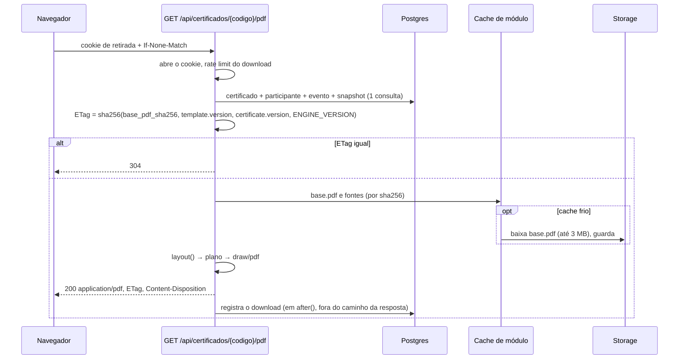

# 05 · Motor de certificados

O coração do produto e o maior risco técnico. Tudo aqui é lógica pura, isolada em `src/features/certificate/`, sem nenhum import de `next/*`, de banco ou de Storage: recebe bytes e dados, devolve bytes ou strings. **TDD obrigatório** ([doc 11](11-qualidade.md)).

## Decisões em uma tela

| Tema | Decisão | Registro |
|---|---|---|
| Biblioteca | `@cantoo/pdf-lib` + `@cantoo/fontkit` | [ADR-0002](adr/0002-fork-cantoo-do-pdf-lib.md) |
| Arquitetura | `layout()` puro gera um plano; dois desenhistas burros (PDF e SVG) consomem o mesmo plano | [ADR-0003](adr/0003-layout-puro-e-dois-desenhistas.md) |
| Arte | normalizada uma vez, na publicação, em um `base.pdf` de página canônica (maior lado = 841,89 pt) | [ADR-0008](adr/0008-pagina-canonica-e-base-pdf.md) |
| Coordenadas | normalizadas de 0 a 1, origem no topo-esquerda; a inversão do y existe em **uma** função | este doc |
| Conteúdo | o modelo declara `data_fields`; os campos posicionados referenciam dados por placeholder | [ADR-0004](adr/0004-payload-dinamico-no-certificado.md) |
| Fonte | sempre embutida, com subset por documento; fonte parseada em cache de módulo | este doc |
| Texto que não cabe | encolhe até o mínimo, depois quebra; nunca vaza, nunca trunca | este doc |
| Prévia | SVG com glifos como paths, gerada pelo mesmo plano. Sem pdf.js no celular. | este doc |

## Por que `@cantoo/pdf-lib`

O trabalho é desenhar texto e um QR **sobre um PDF ou imagem que já existe**. Isso elimina `@react-pdf/renderer` e pdfkit (geram documentos do zero, não compõem sobre PDF existente) e Chromium/Puppeteer (50 MB ou mais de binário e cold start de segundos, no exato endpoint que recebe o pico do dia do evento). Sobra a família pdf-lib: JavaScript puro, isomórfica (roda no Node e no navegador), carrega PDF existente, embute fonte com subset.

O `pdf-lib` original teve o último publish em 06/11/2021. O fork `@cantoo/pdf-lib` (MIT, como o original e como este projeto) mantém a mesma API, teve release em 15/09/2026 e recomenda o `@cantoo/fontkit` (MIT, baseado no fontkit v2, release em 11/09/2026). As duas dependências entram juntas. Se o fork for abandonado, a volta ao original é troca de import: o motor usa só a API comum (`PDFDocument.load`, `embedPage`, `embedPng`, `embedJpg`, `embedFont`, `drawText`, `drawSvgPath`, `save`).

## Estrutura do módulo

```
src/features/certificate/
├── schema.ts          # Zod: DataField, LayoutField, TemplateSnapshot (schema_version 1)
├── reserved-keys.ts   # chaves proibidas em data_fields (guardrail do CPF)
├── data-schema.ts     # buildDataSchema(dataFields) → Zod do payload de certificates.data
├── tokens.ts          # catálogo de placeholders e resolve(content, context)
├── format.ts          # datas, horas e números em pt-BR; title case pt-BR
├── code.ts            # Crockford: normalizeCode, formatCode, isValidCode
├── fonts/
│   ├── catalog.ts     # fontes curadas (ref → arquivo)
│   ├── metrics.ts     # adaptador fontkit → FontMetrics (medida, ascent, descent, glifos)
│   └── coverage.ts    # cobertura de glifos pt-BR
├── layout/
│   ├── coords.ts      # normalizado ↔ pt; toPdfY(), a única inversão de eixo
│   ├── fit-text.ts    # encolher e quebrar
│   └── layout.ts      # layout(snapshot, context, fonts) → RenderPlan
├── qr.ts              # matriz → path SVG único
├── draw/
│   ├── pdf.ts         # RenderPlan + base.pdf → bytes
│   └── svg.ts         # RenderPlan + URL do fundo → string SVG
├── base-pdf.ts        # arte (PDF, PNG, JPG) → base.pdf canônico
├── etag.ts
└── index.ts           # generateCertificatePdf(), renderCertificateSvg()
```

Fora do módulo puro, `src/lib/certificate-assets.ts` busca bytes (disco para fontes curadas, Storage para `base.pdf` e fontes do admin) e mantém o cache de módulo.

## Formato do modelo (`schema_version: 1`)

### `data_fields`: o conteúdo que o modelo declara

```ts
type DataField = {
  key: string        // ^[a-z][a-z0-9_]{1,39}$ e fora das chaves reservadas
  label: string      // pt-BR, 2 a 60: "Título da palestra"
  type: 'text' | 'number' | 'date' | 'hours'
  required: boolean
  default: string | null      // aplicado quando a célula vem vazia
  format:                     // por tipo
    | { type: 'text'; max_length: number }                           // 1 a 300, padrão 120
    | { type: 'number'; decimals: 0 | 1 | 2 }
    | { type: 'date'; style: 'short' | 'long' }                      // 12/09/2026 | 12 de setembro de 2026
    | { type: 'hours'; style: 'number' | 'short' | 'long' }          // 8 | 8h | 8 horas
}
```

Máximo de 20 `data_fields` por modelo. `buildDataSchema(dataFields)` gera o Zod do payload: é ele que a importação usa para validar cada linha contra **o modelo daquela linha** ([doc 06](06-importacao-csv.md)) e que o formulário de edição manual do certificado usa.

A declaração fica em lista própria, e não dentro de cada campo posicionado, por um motivo prático: a mesma chave aparece em mais de um lugar (carga horária na frente e no verso, título da palestra dentro de um parágrafo). Declarar uma vez e referenciar por placeholder evita duas declarações divergentes da mesma chave.

**Guardrail inegociável: CPF nunca é conteúdo.** Duas barreiras, porque uma só falha:

1. *Na chave* (`reserved-keys.ts`): a chave é normalizada (sem acento, minúsculas, sem `_`, `-` e espaço) e recusada se for igual a `cpf`, `nome`, `name`, `fullname`, `nomecompleto`, `email`, `nascimento`, `datanascimento`, `datadenascimento`, `birthdate`, `rg`, `documento`, ou se **contiver** `cpf`. Vale também para o `label`.
2. *No valor*, na importação: qualquer valor de conteúdo que, reduzido a dígitos, tenha 11 dígitos e dígitos verificadores de CPF válidos é recusado com `CONTENT_LOOKS_LIKE_CPF`. É a barreira que pega o admin que chamou o campo de "registro".

### `layout_fields`: o que é desenhado e onde

```ts
type Box = { x: number; y: number; w: number; h: number }   // todos em [0, 1], topo-esquerda

type TextField = {
  id: string                  // uuid gerado no editor
  kind: 'text'
  page: 1 | 2
  box: Box
  content: string             // texto com placeholders: "{{participant.full_name}}"
  font: string                // 'curated:poppins-600' | 'custom:<uuid>'
  size_pt: number             // 6 a 200, na página canônica
  min_size_pt: number         // 6 a size_pt
  color: string               // #RRGGBB. Pertence à arte, não à UI: é a única cor livre do sistema.
  h_align: 'left' | 'center' | 'right'
  v_align: 'top' | 'middle' | 'bottom'
  line_height: number         // 1.0 a 2.0, padrão 1.15
  max_lines: number           // 1 a 8, padrão 2
  fit: 'shrink_then_wrap' | 'wrap_then_shrink'
  transform: 'none' | 'uppercase' | 'title_pt_br'
}

type QrField = {
  id: string
  kind: 'qr'
  page: 1 | 2
  box: Box                    // o QR ocupa o maior quadrado centrado na caixa
  dark: string                // padrão #000000
  light: string | null        // padrão #FFFFFF; null = transparente
}
```

Máximo de 40 campos por modelo. Um "campo simples" é só um `TextField` cujo `content` é um único placeholder. Um parágrafo ("participou como palestrante com a palestra {{data.titulo_palestra}}, com carga horária de {{certificate.hours_long}}") é o mesmo tipo com `fit: 'wrap_then_shrink'` e `max_lines` maior. Texto rico (negrito no meio da frase) é não-objetivo: quem precisa disso põe o nome em uma linha própria, que é como quase todo certificado é diagramado.

### Placeholders (`tokens.ts`)

Lista fechada, sem linguagem de filtros. Formatos alternativos são tokens distintos.

| Token | Valor |
|---|---|
| `{{participant.full_name}}` | nome como gravado |
| `{{participant.cpf_masked}}` | `***.***.**1-45`, a partir de `cpf_last3`; string vazia se não houver CPF |
| `{{event.title}}` · `{{event.location}}` · `{{event.city}}` | |
| `{{event.date_short}}` · `{{event.date_long}}` | `12/09/2026` · `12 de setembro de 2026`; intervalo quando `ends_at` cai em outro dia: `12 a 14 de setembro de 2026` (em `America/Sao_Paulo`) |
| `{{participation.label}}` | "Palestrante" |
| `{{certificate.hours}}` · `{{certificate.hours_short}}` · `{{certificate.hours_long}}` | `8` · `8h` · `8 horas` (`1 hora`, `1,5 hora`) |
| `{{certificate.code}}` | `ABCD-EFG-HJK` |
| `{{certificate.validation_url}}` | `eventos.codingferpa.org/validar/ABCDEFGHJK` (sem `https://`, para caber) |
| `{{certificate.issued_at_short}}` · `{{certificate.issued_at_long}}` | |
| `{{certificate.sequence}}` · `{{certificate.sequence_year}}` | `0042` · `0042/2026` (responde à questão aberta 5 do PRD a custo zero) |
| `{{data.<key>}}` | valor de `certificates.data[key]`, formatado conforme o `format` do `DataField` |

A máscara do CPF é `***.***.**X-XX` porque só os 3 últimos dígitos existem. O formato habitual (`***.456.789-**`) exigiria guardar 6 dígitos do meio, o que derrubaria o espaço de busca do hash para mil candidatos: não será feito. Placeholder desconhecido ou `data.<key>` não declarada impede salvar o modelo.

### Regras de publicação (`publishTemplate`)

O modelo só é publicado se: (1) existe `base.pdf` válido; (2) pelo menos um campo de texto contém `{{participant.full_name}}`; (3) existe exatamente um campo `qr`; (4) pelo menos um campo de texto contém `{{certificate.code}}` (validação "com código e QR em todo certificado": a secretaria sem câmera digita o código); (5) todas as fontes referenciadas existem e têm cobertura de glifos; (6) toda caixa está inteira dentro da página (`x + w <= 1`, `y + h <= 1`); (7) nenhum certificado existente dos tipos que usam o modelo fica sem um campo `required` sem `default`. A violação de (7) responde com a contagem e a chave ("37 certificados não têm `titulo_palestra`").

## Arte: o `base.pdf` canônico

Acontece **uma vez**, na publicação, em `base-pdf.ts`. O caminho quente nunca sabe se a arte era PDF ou imagem.

1. **Página canônica.** Seja `(w, h)` o tamanho da página da arte. `k = 841,89 / max(w, h)`. A página do `base.pdf` mede `(w·k, h·k)` pt. Arte A4 paisagem fica idêntica; arte 1920×1080 do Canva vira 841,89 × 473,56 pt. Com isso "32 pt" significa a mesma coisa em qualquer arte, e trocar a arte por outra de mesmo formato e resolução diferente não desalinha nem redimensiona nada.
2. **Arte em PDF:** `PDFDocument.load` (PDF cifrado é recusado), 1 ou 2 páginas (mais que isso é recusado), `/Rotate` diferente de 0 é recusado com instrução de reexportar. Cada página entra por `embedPage` e é desenhada escalada na página canônica. Efeito colateral desejado: JavaScript, formulários e metadados do arquivo original não são copiados.
3. **Arte em imagem:** PNG por `embedPng` (sem perda), JPG por `embedJpg` (passagem direta, sem recompressão). Maior lado abaixo de 1.200 px é recusado; abaixo de 2.000 px gera aviso de baixa resolução para impressão. Uma imagem é uma página; frente e verso em imagem são dois arquivos.
4. **Orçamento de tamanho:** `base.pdf` ≤ **3 MB** (3.145.728 bytes), verificado aqui e por check no banco. Motivo: a resposta de uma Vercel Function é limitada a 4,5 MB, e o PDF final é o `base.pdf` mais fontes em subset e texto (dezenas de KB). Acima do limite: erro `ART_TOO_HEAVY` com a instrução "exporte a arte como PDF (recomendado) ou JPG em alta qualidade". Nenhuma conversão automática de formato: recompressão silenciosa de arte com texto fino é o tipo de surpresa que aparece impressa.
5. **Fundo da prévia:** gerado **no navegador do admin**, no upload: pdf.js rasteriza a página do PDF (ou o canvas redimensiona a imagem) em WebP com maior lado de 1.600 px, alvo ≤ 200 KB, e sobe para o bucket `previews`. O servidor nunca rasteriza nada, e por isso não há Chromium, `node-canvas` nem `sharp` no runtime.

## Frente e verso

Modelo de duas páginas é caso de primeira classe, porque certificado acadêmico costuma trazer o conteúdo programático no verso.

- **Arte em PDF:** o arquivo tem 1 ou 2 páginas; a primeira é a frente. **Arte em imagem:** dois arquivos, enviados como "frente" e "verso".
- As duas páginas passam pela mesma normalização, **cada uma com a sua página canônica** (frente paisagem e verso retrato é permitido, embora raro). `pages` no modelo guarda tamanho e fundo de prévia de cada uma.
- Todo campo posicionado tem `page: 1 | 2`, e o plano de renderização tem um `PagePlan` por página. O conteúdo programático em si é **arte** (texto estático do designer); o motor só posiciona campos dinâmicos sobre ele, tipicamente carga horária, código, QR e sequência.
- As regras de publicação valem para o conjunto: o nome, o QR e o código podem estar em qualquer das duas páginas.
- O orçamento de 3 MB é do `base.pdf` inteiro, não por página.
- Na tela de retirada e no editor, a prévia tem o seletor "Frente / Verso"; a frente é renderizada primeiro e o verso sob demanda.

## Sistema de coordenadas

Três espaços, uma regra para cada fronteira:

| Espaço | Origem | Unidade | Onde vive |
|---|---|---|---|
| Normalizado | topo-esquerda, y para baixo | 0 a 1 | banco, editor, `LayoutField.box` |
| Plano | topo-esquerda, y para baixo | pt da página canônica | `RenderPlan` |
| PDF | **base**-esquerda, y para **cima** | pt | só dentro de `draw/pdf.ts` |

```ts
// layout/coords.ts
export const toPt = (box: Box, page: { widthPt: number; heightPt: number }) => ({
  x: box.x * page.widthPt, y: box.y * page.heightPt,
  w: box.w * page.widthPt, h: box.h * page.heightPt,
})

/** A única inversão de eixo do sistema. `yTopPt` é medido a partir do topo. */
export const toPdfY = (pageHeightPt: number, yTopPt: number) => pageHeightPt - yTopPt
```

O plano guarda, para cada linha de texto, a posição da **linha de base** medida a partir do topo. `drawText` do PDF recebe `y = toPdfY(pageHeight, baselineYPt)`: como o PDF posiciona texto pela linha de base, não há soma de altura de fonte a fazer, que é onde toda implementação erra. O SVG usa os números do plano sem conversão (`viewBox` em pt). O QR usa `drawSvgPath`, que já trabalha em coordenadas de SVG a partir de um ponto de origem: `x = xPt`, `y = toPdfY(pageHeight, yPt)`.

O editor converte pixel da prévia em normalizado dividindo pelo tamanho **renderizado** do elemento da prévia (`getBoundingClientRect`), nunca pelo tamanho intrínseco da imagem. Trocar a arte, o zoom ou a largura da janela não muda nenhum número gravado.

## Fontes

- **Sempre embutidas.** `StandardFonts` é proibido no projeto (regra de lint `no-restricted-imports` para `StandardFonts`): usa WinAnsi e quebra `ç`, `ã`, `õ`.
- **Curadas** (todas SIL OFL 1.1, TTF **estáticos** em `public/fonts/cert/`): Poppins, Inter, Montserrat, Lora, Playfair Display, nos pesos 400, 600 e 700. Referência: `curated:poppins-600`. O `next.config` inclui a pasta nas funções que geram PDF (`outputFileTracingIncludes`), e o M5 só fecha depois de gerar um PDF em uma Preview da Vercel, porque arquivo que existe no `pnpm dev` e some no deploy é um clássico.
  - **Recorte do M5: só a Poppins.** Conferido em 2026-09-28 no `google/fonts`: das cinco famílias, só a Poppins é distribuída em estáticos por peso. Inter, Montserrat, Lora e Playfair Display existem apenas como variáveis (`Inter[opsz,wght].ttf` etc.), e o pdf-lib embute a fonte como ela é, sem instanciar o eixo `wght`: sairia 400 em tudo, sem erro. As quatro entram no M6, com ADR próprio (instanciar num passo de build, buscar os estáticos na distribuição de cada projeto, ou cortar o catálogo), escolhido com medição.
  - **Onde os bytes moram, e por quê em `public/`.** A leitura não é só de servidor: o editor do M6 roda o motor no navegador do admin e busca os mesmos bytes em `/fonts/cert/`. Por isso as TTFs ficam em `public/`. Como `public/` é servido pela CDN e **não** é traçado para dentro da função, cada rota que gera PDF declara a pasta em `outputFileTracingIncludes`, e o servidor lê por `fs` a partir de `process.cwd()`. Um passo do CI confere, depois do build, que as TTFs aparecem no rastro (`.nft.json`) de cada rota que gera PDF: o engano vira erro de CI, e não certificado quebrado em produção. O juiz final continua sendo o PDF baixado de uma Preview.
- **Enviadas pelo admin** (`custom:<uuid>`): TTF ou OTF até 2 MB. Fonte variável (tabela `fvar`) é recusada: o embutimento de variáveis não é confiável. No upload rodam dois testes, e os resultados ficam em `custom_fonts`: cobertura de glifos e ida e volta do subset.
- **Cobertura de glifos** (`coverage.ts`): a fonte precisa ter glifo para `A-Z a-z 0-9`, `ÁÀÂÃÄÉÊËÍÏÓÔÕÖÚÜÇÑ` e minúsculas, `ªº°`, e a pontuação `.,;:!?-/()'"`. Sem isso, não entra.
- **Subset no caminho quente:** `embedFont(bytes, { subset: true, features: { liga: false } })`. Cada PDF carrega só os glifos usados (um certificado com Poppins embutida inteira teria 150 KB a mais; com subset, poucos KB). Ligaduras desligadas para que a medida do layout, o PDF e o SVG concordem glifo a glifo.
- **Subset com defeito:** o subset do pdf-lib tem histórico de corromper algumas fontes (sobretudo OTF/CFF). Por isso o teste de ida e volta: gerar um PDF com o pangrama acentuado, extrair o texto com pdf.js e comparar. Fontes curadas passam por ele no CI; fonte enviada que falha fica com `subset_ok = false` e é embutida inteira.
- **Fonte parseada em cache, não só os bytes.** O pdf-lib chama `fontkit.create(bytes)` a cada `embedFont`. O motor registra um adaptador que memoriza o resultado por identidade do `Uint8Array`:

```ts
const parsed = new WeakMap<Uint8Array, Font>()
export const cachedFontkit = {
  create: (bytes: Uint8Array) => parsed.get(bytes) ?? (parsed.set(bytes, fontkit.create(bytes)), parsed.get(bytes)!),
}
// pdfDoc.registerFontkit(cachedFontkit)
```

  O mesmo objeto `Font` serve ao `layout()` (medidas) e ao pdf-lib (embutimento). Teste obrigatório que sustenta a decisão: gerar dois PDFs em sequência, com nomes diferentes, a partir da mesma fonte em cache, e extrair o texto dos dois. Se houver vazamento de estado entre documentos, o teste falha e o fallback documentado é cachear só os bytes (custo de 5 a 15 ms de parse por download, aceitável).
- **Glifo ausente em tempo de geração** (nome com caractere fora da cobertura): o campo inteiro é desenhado com a Inter de peso mais próximo e o plano registra `GLYPH_FALLBACK`. Nunca sai um quadrado vazio no lugar de uma letra.
  - **Lacuna conhecida até o M6.** Sem a Inter, o fallback do M5 é a Poppins de peso mais próximo, que cobre todo o português e o latim estendido (ł, ő, ş, ğ, ž), mas não vietnamita, grego nem cirílico. O mecanismo é testado com uma fonte de teste sem `ç`, que cai na Poppins sem nenhum `.notdef`; um nome em alfabeto não latino, porém, só fica coberto quando o M6 trouxer uma família de cobertura ampla. Até lá, o plano registra `GLYPH_FALLBACK` com os caracteres que nenhuma fonte cobre.

## Algoritmo de ajuste de texto (`fit-text.ts`)

Medida: `widthAt(text, size) = Σ advanceWidth(glifos de font.layout(text, { liga: false })) / unitsPerEm × size`. É a mesma conta que o pdf-lib faz em `widthOfTextAtSize`; um teste de invariância compara as duas para 50 nomes com tolerância de 0,01 pt. Como a largura é linear no tamanho, encolher é uma divisão, não uma busca.

Entrada: texto já resolvido e transformado, caixa em pt (`W`, `H`), `size`, `min`, `maxLines`, `lineHeight`, modo.

**`shrink_then_wrap`** (nomes e campos curtos):

1. `s1 = min(size, W / widthAt(text, 1), H / lineHeight)`, arredondado para baixo em passos de 0,25 pt. Se `s1 >= min`: uma linha em `s1`. Fim.
2. Para `n` de 2 até `maxLines`: escolher a quebra em `n` linhas, só em espaços, que **minimiza a largura da linha mais larga** (busca exaustiva; um nome tem no máximo uns 12 espaços). Desempate: partícula (`de`, `da`, `do`, `das`, `dos`, `e`) começa a linha de baixo em vez de terminar a de cima. `sn = min(size, W / maiorLinhaAt(1), H / (n × lineHeight))`. Se `sn >= min`: `n` linhas em `sn`. Fim.
3. Nada coube no mínimo: usar `n = maxLines` e o `sn` calculado, **abaixo do mínimo**, e registrar o aviso `BELOW_MIN_SIZE` com o tamanho final. O texto continua inteiro e dentro da caixa.

**`wrap_then_shrink`** (parágrafos): quebra gulosa no tamanho nominal. Se o número de linhas ≤ `maxLines` e `linhas × lineHeight × s <= H`, fim. Senão reduz `s` em 0,5 pt e refaz a quebra, até caber. Abaixo de `min`, segue reduzindo até o piso de 4 pt, com `BELOW_MIN_SIZE`.

Garantias, que são os critérios do PRD: **nunca vaza da caixa, nunca corta texto, nunca usa reticências.** O preço é que um nome absurdo em uma caixa minúscula sai pequeno. Isso é um aviso para o admin antes da emissão, não um erro para o aluno depois: o aviso aparece no botão "testar com o nome mais longo deste evento" e na prévia da importação ("3 nomes ficam abaixo do tamanho mínimo no modelo Participante").

Posicionamento: alinhamento horizontal por linha (`x = box.x`, `box.x + (W - w)/2` ou `box.x + W - w`). Vertical: o bloco mede `n × lineHeight × s`; dentro de cada linha, a linha de base fica em `topoDaLinha + (lineHeight × s - (ascent - descent) × s / upem) / 2 + ascent × s / upem`, com `ascent` e `descent` da tabela `hhea` (descent negativo).

**"Testar com o nome mais longo":** o servidor pega os 5 `full_name` mais longos do evento por contagem de caracteres, mede cada um com a fonte do campo e usa o mais **largo**. Evento sem participantes usa o nome canônico `Maria Eduarda dos Santos Albuquerque Pessoa Rodrigues`.

**`title_pt_br`:** tudo em minúsculas, inicial maiúscula em cada palavra, exceto `de da do das dos e` quando não são a primeira palavra; cada parte de um hifenizado é capitalizada; após apóstrofo também (`d'Ávila` → `D'Ávila`). Casos na matriz de testes.

## O plano de renderização

```ts
type RenderPlan = { pages: PagePlan[]; warnings: LayoutWarning[] }
type PagePlan = { widthPt: number; heightPt: number; items: PlanItem[] }
type PlanItem =
  | { kind: 'text'; fieldId: string; font: string; sizePt: number; color: string;
      lines: { text: string; xPt: number; baselineYPt: number; widthPt: number }[] }
  | { kind: 'qr'; fieldId: string; xPt: number; yPt: number; sizePt: number;
      modules: number; path: string; dark: string; light: string | null }
      // path em unidades de módulo, y para baixo; escala = sizePt / modules (acréscimo do M5)
type LayoutWarning = { fieldId: string; code: 'BELOW_MIN_SIZE' | 'GLYPH_FALLBACK' | 'QR_TOO_SMALL'; detail: string }
```

O plano é JSON serializável e arredondado a 0,01 pt: é ele que os testes de snapshot congelam. **O motor não sabe se os números vieram do formulário (M6) ou do arrastar (M10).**

### Desenhista PDF (`draw/pdf.ts`)

`PDFDocument.load(baseBytes)` → `registerFontkit(cachedFontkit)` → `embedFont` de cada fonte usada → para cada item: `drawText(line.text, { x, y: toPdfY(...), size, font, color })` ou o QR (retângulo de fundo se `light` não for null, depois `drawSvgPath`). Metadados: título `Certificado: {evento}`, autor `Coding Ferpa`, assunto com o código, idioma `pt-BR`. `save({ useObjectStreams: false })`: a imagem do `base.pdf` já está comprimida e o ganho de tamanho não paga a CPU no pico. O texto é texto de verdade (selecionável, extraível, acessível), nunca contorno.

### Desenhista SVG (`draw/svg.ts`)

`<svg viewBox="0 0 W H" role="img" aria-label="Prévia do certificado de {nome}">` com `<image href="{preview_path}">` de fundo e, para cada linha de texto, **os contornos dos glifos como `<path>`** (`glyph.path.toSVG()`, escalados por `size / unitsPerEm` e espelhados no y). Consequências boas: a prévia não depende de fonte instalada nem de webfont (nenhuma fonte é servida ao público, o que elimina a questão de licença de webfont para fonte enviada pelo admin), não há diferença de kerning ou ligadura entre navegador e PDF, e o celular não baixa pdf.js. O QR é o mesmo `path` do plano.

Cada glifo entra uma vez em `<defs>` e as linhas o reusam com `<use x="avanço">`, dentro de um grupo `translate(x linhaDeBase) scale(k -k)` por linha, com `k = size / unitsPerEm`. O id do glifo nasce da referência da fonte e do índice do glifo (`cf-curated-poppins-600-704`): o mesmo id é sempre o mesmo contorno, e duas prévias na mesma página (frente e verso, ou o editor) não trocam letras entre si. Medido no M5, o certificado típico (nome longo, parágrafo de quatro linhas e QR) tem 33,5 KB crus e **8,4 KB comprimidos**; sem a deduplicação, só o parágrafo passaria de 50 KB. O teste guarda o teto de 10 KB comprimido. O rótulo e a URL do fundo são escapados: o nome do participante vai inline na página.

Onde roda: **no servidor** para a tela de retirada (RSC, SVG inline, poucos KB) e **no navegador do admin** para o editor (fontkit carregado por `import()` só nessa tela), o que dá prévia instantânea a cada tecla, sem ida ao servidor.

### Equivalência entre prévia e PDF (critério de 1% do R4)

Não há rasterização no CI. A equivalência é garantida por construção (mesmo plano, mesmos contornos de glifo) e verificada por três asserções baratas:

1. **Snapshot numérico do plano** para cada caso da matriz: pega qualquer regressão de posição ou tamanho.
2. **PDF contra o plano:** o pdf.js (que já é dependência, e roda em Node sem canvas para extração) devolve cada trecho de texto com sua matriz de transformação. O teste afirma que posição e tamanho de cada linha no PDF batem com o plano com tolerância de 0,5 pt, e que o texto extraído é idêntico.
3. **SVG contra o plano:** o teste lê os atributos `transform` dos grupos de glifos e compara com o plano.

Dois desenhistas verificados contra o mesmo plano são equivalentes entre si, dentro da diferença de antialiasing, que é bem menor que 1%.

## QR code

Conteúdo: `{NEXT_PUBLIC_SITE_URL}/validar/{code}` (código sem hífens; 50 caracteres com o domínio de produção). Biblioteca `qrcode-generator` (MIT, zero dependências): só precisamos da matriz, porque o desenho é nosso. Correção de erro **M**, modo byte, o que dá versão 4 (33×33 módulos). A zona de silêncio de 4 módulos fica **dentro** da caixa. `qr.ts` transforma a matriz em um único path (`M x y h1 v1 h-1 z` por módulo escuro, com corridas horizontais fundidas): vetorial no PDF e no SVG, nítido em qualquer tamanho de impressão. Lado menor que 56,7 pt (2 cm na página canônica) gera `QR_TOO_SMALL`: abaixo disso o módulo impresso fica menor que 0,5 mm e câmera de celular barato falha.

## Código de validação

10 símbolos do alfabeto Crockford Base32 `0123456789ABCDEFGHJKMNPQRSTVWXYZ` (sem `I`, `L`, `O`, `U`), 50 bits do CSPRNG, gerados no banco. Exibição `XXXX-XXX-XXX`. Sem dígito verificador: os 10 caracteres são todos entropia, e "não encontrado, confira a digitação" leva a secretaria à mesma ação que um "dígito inválido".

```ts
// code.ts
normalizeCode(' abcd-efg hjk ') // → 'ABCDEFGHJK'
// 1. maiúsculas  2. remove espaços e hífens  3. O→0, I→1, L→1  4. valida ^[0-9A-HJKMNP-TV-Z]{10}$
```

`U` não tem mapeamento: entrada com `U` é `malformed`. O código é **imutável** (trigger): correção de nome incrementa `version` e mantém o código, então o papel que já está na secretaria continua validando, e a página de validação mostra sempre o dado atual, com a nota "dados atualizados em {data}" quando `version > 1`.

## Geração sob demanda: o caminho quente



- **Cache de módulo:** `Map` com no máximo 8 `base.pdf` (LRU, chave `base_pdf_sha256`) e todas as fontes usadas. Guarda-se bytes do `base.pdf` (o `PDFDocument` é mutável, então cada requisição faz seu `load`) e a fonte **parseada**. Com Fluid Compute a instância atende várias requisições e o cache aquece na primeira.
- **Cabeçalhos:** `Content-Type: application/pdf` · `Content-Disposition: attachment; filename="certificado-{slug}-{primeiro-nome}.pdf"` (primeiro nome em ASCII minúsculo; mais `filename*` UTF-8) · `ETag` forte · `Cache-Control: private, no-cache` · `X-Robots-Tag: noindex`.
- **Revogado ou apagado:** o motor nem é chamado; a rota responde 410.
- **Falha de geração:** log estruturado com `certificate_id` e `template_id` (sem nome), contador `pdf_failures`, Sentry, e redirecionamento 303 para a tela de retirada com `?erro=geracao` ([doc 07](07-apis-e-actions.md)). A meta do PRD é zero.
- **Orçamento de pico** (armadilha 10): alvo de 150 ms de CPU por PDF com cache quente. Cem downloads simultâneos, mesmo serializados em uma única instância, terminam em cerca de 15 s, contra o teto de 300 s. `maxDuration = 60` na rota. O M9 inclui `scripts/load-test-download.ts`: 100 requisições concorrentes contra produção, usando o certificado sentinela do seed, antes do anúncio do primeiro evento (p95 < 3 s, zero erro). Não há staging com banco ([doc 02](02-arquitetura.md)).
- **Região:** funções em `gru1`, Supabase em `sa-east-1`. Um `base.pdf` de 3 MB atravessando o Atlântico a cada cold start não é aceitável.

**P2, não construído:** cache do PDF pronto no Storage. Encaixe previsto: objeto `generated/{certificate_id}/{etag}.pdf` em bucket privado; a rota verifica a existência e redireciona para URL assinada. O ETag já é a chave de invalidação, então nada do desenho atual muda.

## Matriz de casos de teste

Fixtures em `tests/fixtures/certificate/`: `art-a4-landscape.pdf` (vetorial), `art-150dpi.png` e `art-300dpi.png` (mesma arte), `art-16x9.pdf`, `art-two-pages.pdf`, `art-rotated.pdf`, `art-encrypted.pdf`, `art-heavy.png` (estoura 3 MB), e modelos JSON correspondentes.

| ID | Caso | Afirmação |
|---|---|---|
| PDF-01 | `José Gonçalves de Assunção`, **para cada fonte curada e peso** | texto extraído do PDF é idêntico (gate de CI inegociável) |
| PDF-02 | `Maria Eduarda dos Santos Albuquerque Pessoa Rodrigues` em caixa de nome típica | cabe; plano em snapshot; nenhuma linha passa da caixa |
| PDF-03 | `Ana Lima` na mesma caixa | tamanho nominal, 1 linha |
| PDF-04 | nome longo com `max_lines: 1` e caixa estreita | `BELOW_MIN_SIZE`, texto inteiro, dentro da caixa |
| PDF-05 | quebra em 2 linhas com partícula | "dos" começa a segunda linha |
| PDF-06 | mesmo modelo sobre `art-150dpi.png` e `art-300dpi.png` | planos **idênticos** (critério "150 para 300 dpi") |
| PDF-07 | `art-16x9.pdf` | página canônica 841,89 × 473,56; campos no lugar |
| PDF-08 | modelo de duas páginas, QR e carga horária no verso | itens na página 2; PDF com 2 páginas |
| PDF-09 | posição no PDF contra o plano, 3 alinhamentos H × 3 V | tolerância 0,5 pt |
| PDF-10 | SVG contra o plano | transforms idênticos ao plano |
| PDF-11 | invariância de medida `metrics` × `widthOfTextAtSize` | 50 nomes, tolerância 0,01 pt |
| PDF-12 | dois PDFs seguidos com a fonte em cache | os dois textos extraídos corretos |
| PDF-13 | QR | decodificado por biblioteca de leitura no teste, igual à URL esperada; módulos = 33 |
| PDF-14 | `normalizeCode`: `o`→`0`, `i`/`l`→`1`, minúsculas, hífens, espaços, `U` inválido | tabela |
| PDF-15 | `base-pdf`: rotacionado, cifrado, 3 páginas, pesado, imagem pequena | cada um com seu código de erro |
| PDF-16 | `base.pdf` a partir de PDF | página canônica correta; sem JavaScript nem formulário no resultado |
| PDF-17 | parágrafo `wrap_then_shrink` com `{{data.titulo_palestra}}` longo | cabe em `max_lines`; snapshot |
| PDF-18 | `title_pt_br` e `uppercase` | tabela (`MARIA DOS SANTOS` → `Maria dos Santos`, `ana-clara d'ávila` → `Ana-Clara D'Ávila`) |
| PDF-19 | tokens: datas, intervalo de datas, horas (`1 hora`, `1,5 hora`, `8 horas`), `cpf_masked`, sequência | tabela |
| PDF-20 | chaves reservadas e valor com cara de CPF | recusados |
| PDF-21 | glifo ausente na fonte do campo | `GLYPH_FALLBACK`, nenhum `.notdef` no PDF |
| PDF-22 | fonte variável e fonte sem `ç` no upload | recusadas |
| PDF-23 | ETag muda com `certificate.version`, `template.version` e `ENGINE_VERSION`; não muda sem mudança | |
| PDF-24 | tamanho do PDF final com `base.pdf` de 3 MB | < 4,5 MB |

O decodificador de QR do PDF-13 (`jsqr`, devDependency) lê a matriz desenhada em um bitmap montado pelo próprio teste a partir do path: não exige rasterizador.

Verificação manual única, no M9, registrada no runbook: abrir um certificado real no Chrome, no Acrobat, no visualizador nativo do Android e no do iOS (critério de aceite do R3 que não se automatiza).
