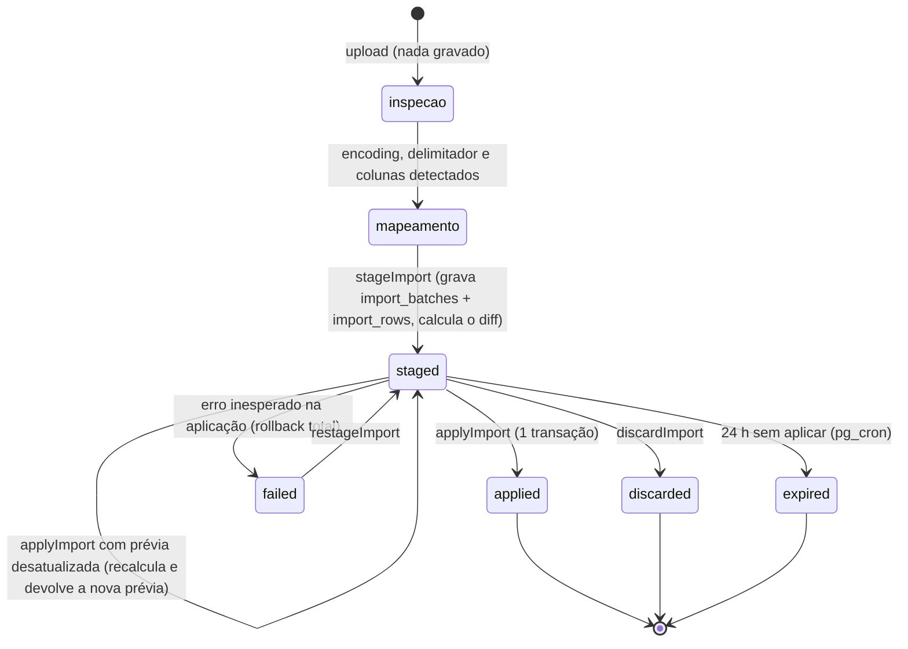

# 06 · Importação de CSV

O segundo risco técnico do projeto. A parte pura (decodificar, detectar, mapear, validar linha) vive em `src/features/import/`, sem `next/*` e sem banco, e é **TDD obrigatório**. A parte de conjunto (conciliar com o que já existe, aplicar) vive em duas funções SQL, porque é o banco que sabe normalizar nome e garantir atomicidade.

## Decisões em uma tela

| Tema | Decisão |
|---|---|
| Colunas | **Dinâmicas por modelo.** O CSV carrega campos de identidade (fixos) mais os campos de conteúdo que o modelo daquela linha declara ([ADR-0004](adr/0004-payload-dinamico-no-certificado.md)). |
| Um CSV por quê? | **Por tipo de participação** (que determina o modelo). É o caminho principal. A planilha única com coluna de tipo é suportada como caso degenerado. |
| Preset de mapeamento | Pertence ao **modelo** (`certificate_templates.column_mapping`), é clonado com ele. |
| Arquivo | **Nunca é persistido.** Trafega duas vezes (inspeção e staging) e morre na memória da função. O staging guarda linhas já normalizadas, com CPF já em HMAC. |
| Encoding | Determinístico, sem biblioteca heurística: BOM → UTF-8 estrito → Windows-1252. |
| Delimitador | Detecção do Papa Parse restrita a `;`, `,`, tab e `\|`, nessa ordem de preferência. |
| Conciliação | Cascata: HMAC do CPF → nome + nascimento → nome + e-mail → nome. Feita em SQL, sobre o staging. |
| Aplicação | Uma transação, `pg_advisory_xact_lock` por evento, diff **recalculado** dentro dela; divergiu da prévia, aborta ([ADR-0011](adr/0011-staging-e-diff-em-sql.md)). |
| Remoção | **Importação nunca remove.** Remoção é ação manual, explícita e auditada ([ADR-0007](adr/0007-upsert-only-e-remocao-manual.md)). |

### Por que um CSV por tipo de participação

Na vida real a lista de presença e a lista de palestrantes nunca saem da mesma fonte: uma vem do formulário de inscrição, a outra de uma conversa no WhatsApp. Uma planilha única com a união das colunas produz um arquivo cheio de células vazias que o admin preenche errado às 23h. Então o assistente começa perguntando **"De quem é esta lista?"** com os tipos do evento. A escolha fixa o tipo (e portanto o modelo) do lote inteiro, dispensa a coluna de tipo e permite aplicar o preset do modelo.

A última opção da pergunta é **"Vários tipos (a planilha tem uma coluna de tipo)"**. Nesse modo `import_batches.participation_type_id` fica null, o mapeamento inclui o alvo `participation_type`, os alvos de conteúdo são a união das `data_fields` dos modelos do evento, e cada linha é validada contra o modelo do seu tipo. O roteamento por tipo precisa existir de qualquer jeito (é ele que decide o que exigir de cada linha), então o caso degenerado sai quase de graça. Nesse modo o preset não é aplicado nem salvo.

## Máquina de estados do lote

`inspecao` e `mapeamento` são estados **da tela**, não do banco: até o admin pedir a prévia, nada foi gravado. Estados persistidos (`import_status`): `staged`, `applied`, `discarded`, `failed`, `expired`.

## Os quatro passos

### 1. Upload e inspeção (`inspectCsv`, não grava nada)

Entrada: arquivo (`FormData`), `event_id`, `participation_type_id | null`. Limites: `.csv` ou `.txt`, até **2 MB** e **5.000 linhas** (um evento de 300 pessoas tem 30 KB). `serverActions.bodySizeLimit` fica em `3mb`.

Saída: `{ encoding, delimiter, headers[], sample_rows[10], row_count, file_sha256, suggested_mapping, warnings[] }`. Avisos possíveis: `MOJIBAKE_SUSPECTED`, `ALREADY_APPLIED` ("este mesmo arquivo foi aplicado em {data}", por `file_sha256`), `SINGLE_COLUMN`.

A tela mostra as 10 primeiras linhas **já decodificadas**. Se o acento estiver errado, o admin vê aqui, antes de qualquer coisa ir para o banco.

### 2. Mapeamento

Cada alvo recebe uma coluna do arquivo ou "não importar".

| Grupo | Alvos | Observação |
|---|---|---|
| Identidade (fixos) | `full_name` (**obrigatório**), `cpf`, `birth_date`, `email` | os únicos usados em busca e conciliação |
| Sistema | `participation_type` (só no modo vários tipos), `hours` | `hours` sem coluna usa o `default_hours` do tipo |
| Conteúdo (dinâmicos) | uma entrada por `data_field` do modelo, com o `label` e o tipo | `required` sem coluna e sem `default` bloqueia o avanço |

Sugestão automática (`features/import/mapping.ts`): primeiro o preset do modelo (casamento por cabeçalho normalizado: sem acento, minúsculas, pontuação vira espaço); depois um dicionário de sinônimos (`nome`, `nome completo`, `nome do aluno`, `nome do participante`, `participante` → `full_name`; `cpf`, `documento` → `cpf`; `nascimento`, `data de nascimento`, `dt nasc` → `birth_date`; `e mail`, `email`, `endereco de e mail` → `email`; `carga horaria`, `horas`, `ch` → `hours`; `tipo`, `categoria`, `participacao` → `participation_type`); depois o `label` e a `key` de cada `data_field`. Casamento só por igualdade do cabeçalho normalizado, e cada coluna é sugerida para um alvo só. `nome do participante` e `endereco de e mail` são os cabeçalhos do Google Forms, de onde a lista de inscrição costuma sair. A sugestão nunca é aplicada sem o admin ver.

A normalização de cabeçalho é uma função própria em TypeScript (`normalizeHeader`), e não a `normalize_person_name`: cabeçalho e tipo só se comparam entre si, nunca com valor do banco, e o nome de pessoa tem fonte única no SQL (doc 04). Ela também não tira partículas, para `nome do aluno` e `data de nascimento` continuarem legíveis no preset gravado.

O servidor revalida o mapeamento, porque ele volta do navegador (`checkMapping`): alvo que não existe no modelo (`UNKNOWN_TARGET`) e coluna que não existe no arquivo (`UNKNOWN_HEADER`) bloqueiam; `full_name` sem coluna bloqueia; no modo vários tipos, `participation_type` sem coluna bloqueia. O `data_field` obrigatório sem coluna e sem `default` bloqueia só no modo tipo único; no modo vários tipos ele depende do tipo de cada linha, e quem acusa é a validação da linha (`FIELD_REQUIRED`).

Aviso no próprio passo: se o evento habilita busca por CPF e a coluna de CPF não foi mapeada, a tela diz "sem CPF, estas pessoas não poderão buscar o certificado por CPF".

Ao avançar com sucesso, o mapeamento confirmado é gravado em `certificate_templates.column_mapping` (formato `{ target: header_normalizado }`). No próximo evento clonado, a tela de mapeamento já abre preenchida.

### 3. Prévia (`stageImport`)

Entrada: o arquivo **de novo**, o mapeamento, `event_id`, `participation_type_id | null`. O servidor refaz a decodificação e o parse (a inspeção não deixou nada), valida cada linha, calcula o HMAC dos CPFs, grava `import_batches` (`staged`) e `import_rows`, chama `compute_import_diff(batch)` e devolve o resumo.

Resumo exibido, sempre **em certificados** (uma linha do arquivo é um certificado):

| Contador | Significado |
|---|---|
| A criar | certificado novo. Subtotal "pessoas novas" ao lado. |
| A atualizar | pessoa e certificado existem, algum valor mapeado mudou. A tela mostra o antes e o depois por campo. |
| Inalterados | tudo igual |
| Com erro | linha inválida: número da linha, campo e motivo. **Não bloqueia as demais.** |
| Pedem decisão | possível duplicata: bloqueia a aplicação até o admin decidir |
| Ausentes no arquivo | só no modo de tipo único: certificados daquele tipo que estão no banco e não vieram no arquivo. Informativo, **nada é removido**. |

Mais os avisos não bloqueantes agregados (homônimos, nomes abaixo do tamanho mínimo no modelo, linhas sem nenhuma chave de busca habilitada).

### 4. Aplicação (`applyImport`)

Entrada: `batch_id` e o `preview_digest` que a tela recebeu. Tudo dentro de `apply_import(batch, expected_digest)`, em uma transação:

1. `pg_advisory_xact_lock(hashtext('import:' || event_id))`: duas importações do mesmo evento nunca correm juntas.
2. Recalcula o diff com o estado **atual** do banco.
3. Calcula o digest do plano (sha256 de `row_number:action:matched_participant_id:matched_certificate_id` de todas as linhas, em ordem). O participante entrou na implementação, mais estrito que o desenho original: sem ele, alguém cadastrar à mão, entre a prévia e a aplicação, a pessoa que a linha ia criar mudaria o plano (o certificado passa a ir para quem já existe) sem mudar a ação, e a prévia não ficaria velha. Se for diferente do esperado, grava o novo resumo, **não escreve nada** e devolve `preview_stale`: a tela mostra a prévia nova com o aviso "a lista mudou desde a prévia".
4. Se ainda houver linha `needs_decision` sem `resolution`, devolve `decisions_pending`.
5. Aplica: insere participantes novos; atualiza os existentes; insere certificados (`code` por `generate_certificate_code()`, `sequence_number` contínuo por evento, `issued_at = now()` se o evento já estiver liberado); atualiza certificados (o trigger incrementa `version`). Linhas `error` e `skipped` são ignoradas.
6. Marca o lote `applied`, grava os contadores finais e o `audit_logs` (`import.apply`, com contadores, **sem linhas e sem nomes**).

A função devolve `{ status, summary }`, com `status` em `applied`, `preview_stale` (com o digest novo), `decisions_pending`, `not_staged` (o lote já foi aplicado, descartado ou expirou; é o que a segunda aplicação do **mesmo** lote recebe depois de esperar o lock) e `failed`.

Qualquer exceção dentro da função desfaz tudo. Implementado com um bloco `begin ... exception` em volta da escrita: o que o bloco escreveu volta, e fica só o lote marcado `failed`, com a mensagem do erro (sem o detalhe, que pode citar valores da linha). Tabela de casos em `supabase/tests/12_aplicacao.sql`, inclusive a colisão de código no meio do lote. É assim que "erro na linha 400 de 500 não deixa o banco pela metade" deixa de ser uma promessa e vira propriedade do desenho. Depois do commit: `updateTag('event:{slug}')`.

Regras de escrita:

- **Célula vazia nunca apaga valor existente.** Vazio significa "sem informação". Para apagar um dado, edita-se o participante.
- **Coluna não mapeada não é comparada nem tocada.**
- O `default` de um `data_field` só preenche certificado **novo**. Na atualização, campo vazio ou sem coluna fica como está.
- Mudança de `full_name` incrementa `version` de todos os certificados ativos da pessoa. O código não muda.
- Certificado `revoked` ou `erased` nunca é atualizado nem recriado pela importação: a linha vira `skipped` com o aviso `CERTIFICATE_REVOKED`. **Pendente para `erased`:** depois da eliminação nada reconhece a pessoa (doc 08), e esta regra é impossível como está escrita; ver a proposta do [ADR-0017](adr/0017-reimportacao-de-quem-pediu-eliminacao.md). `revoked` funciona como descrito.

## Detecção de encoding, BOM e delimitador (`features/import/decode.ts`)

Algoritmo exato, sem dependência:

1. Bytes `EF BB BF` → UTF-8, BOM removido.
2. Bytes `FF FE` → UTF-16LE; `FE FF` → UTF-16BE. BOM removido. (É o "Texto Unicode" do Excel.)
3. `new TextDecoder('utf-8', { fatal: true }).decode(bytes)`. Deu certo → UTF-8. ASCII puro cai aqui.
4. Falhou → `new TextDecoder('windows-1252').decode(bytes)`, que nunca falha. Windows-1252 é superconjunto imprimível do ISO-8859-1, então cobre os dois.
5. Conferência pós-decodificação: se o texto contém `U+FFFD` ou alguma das assinaturas `ç`, `ã`, `á`, `é`, `ê`, `í`, `ó`, `õ`, `ú`, emite `MOJIBAKE_SUSPECTED` (arquivo que já chegou estragado de outro sistema: não dá para consertar, mas dá para avisar).
6. O texto sai recomposto em NFC (`text.normalize('NFC')`). Acento decomposto, comum em arquivo vindo de Mac, parece igual na tela, mas não casava com o nome digitado na busca nem com o homônimo (medido; ver `normalize_person_name` no doc 04, que também recompõe).

Por que funciona sem heurística estatística: texto em Windows-1252 com acento quase nunca é UTF-8 válido (um `ç` isolado, byte `E7`, exige dois bytes de continuação que não estarão lá), e UTF-8 válido com caracteres não ASCII quase nunca é o que um Excel pt-BR produz por acidente. O passo 3 decide com exatidão o caso que importa, e bibliotecas como `chardet` erram justamente em arquivos pequenos. O Node 24 tem ICU completo: `windows-1252`, `utf-16le` e `utf-16be` estão disponíveis no `TextDecoder`. Mac Roman (Excel antigo de Mac) não é suportado: é raro, e o passo 5 não o detecta; está registrado como limitação no texto de ajuda da tela.

Parse com **Papa Parse** (`features/import/parse.ts`), em duas passadas. A primeira só adivinha o delimitador: `delimiter: ''`, `delimitersToGuess: [';', ',', '\t', '|']`, `skipEmptyLines: 'greedy'`, nas 50 primeiras linhas. A segunda é o parse de verdade, com o delimitador fixo, `header: false` (o cabeçalho é tratado por nós) e **sem** pular linha vazia. O motivo foi medido: o palpite do Papa compara o número de colunas entre linhas, e uma linha vazia (uma coluna só) derruba a conta, então ele precisa pular as vazias; já o `skipEmptyLines` no parse desloca a numeração, e o número de cada linha tem de ser o do Excel, para o admin achar a linha do erro na própria planilha. As vazias são ignoradas depois, contando. No empate vale a ordem da lista. A primeira linha não vazia é o cabeçalho; colunas finais totalmente vazias são descartadas; cabeçalhos repetidos ganham sufixo (`nome (2)`); coluna com dado e sem cabeçalho (cabeçalho vazio, ou linha mais longa que ele) vira `Coluna N` em vez de sumir calada, e linha mais curta é completada com células vazias. Aspas, delimitador dentro de aspas e quebra de linha dentro de campo são problema do Papa, e há fixture para cada um. Menos de 2 colunas detectadas → erro `SINGLE_COLUMN` com a dica de conferir o delimitador.

## Validação por linha (`features/import/validate-row.ts`)

Função pura: `(célulasMapeadas, contexto) → { staged, issues[] }`. O contexto traz os tipos do evento, as `data_fields` de cada modelo (por tipo), o tipo fixo do lote e a configuração de busca do evento. **A linha é roteada para o modelo do seu tipo antes de validar o conteúdo**: palestrante sem `titulo_palestra` é erro; participante sem `titulo_palestra` não é.

Normalizações de entrada:

- **Nome:** trim, espaços colapsados. Gravado como veio (a transformação de caixa é do modelo, não do dado).
- **CPF:** só dígitos. Com 9 ou 10 dígitos, completa com zeros à esquerda (o Excel come zero inicial de coluna numérica). Notação científica (`1,23457E+10`) é irrecuperável: erro com instrução. O CPF vira `cpf_hash` e `cpf_last3` **dentro desta função** e o valor em claro não sai dela.
- **Data:** `dd/mm/aaaa`, `dd-mm-aaaa`, `dd.mm.aaaa`, `aaaa-mm-dd` e número serial do Excel (inteiro entre 10000 e 60000, base 1899-12-30). Ano com 2 dígitos é recusado (ambíguo para nascimento). `mm/dd` nunca é presumido.
- **E-mail:** trim e minúsculas.
- **Horas:** aceita `8`, `8,5`, `8.5`, `8h`, `8 horas`.
- **Tipo:** casado por `slug`, `label` ou `aliases`, tudo pela regra de normalização de cabeçalho.

| Código | Severidade | Regra |
|---|---|---|
| `NAME_REQUIRED` | erro | vazio após trim |
| `NAME_TOO_SHORT` / `NAME_TOO_LONG` | erro | menos de 3 caracteres úteis normalizados; mais de 120 |
| `NAME_SINGLE_WORD` | aviso | uma palavra só: a busca por nome exige o nome completo |
| `CPF_INVALID` | erro | dígito verificador não confere |
| `CPF_REPEATED_DIGITS` | erro | `111.111.111-11` e similares |
| `CPF_SCIENTIFIC_NOTATION` | erro | "formate a coluna de CPF como texto na planilha e exporte de novo" |
| `DATE_UNRECOGNIZED` / `DATE_IMPLAUSIBLE` | erro | formato fora da lista; antes de 1900 ou a menos de 5 anos de hoje |
| `EMAIL_INVALID` | erro | `z.email()` |
| `HOURS_INVALID` | erro | não numérico, negativo ou acima de 9999,9 |
| `TYPE_UNKNOWN` | erro | valor da coluna de tipo não casa com nenhum tipo do evento |
| `TYPE_WITHOUT_TEMPLATE` | erro | o tipo não tem modelo: não há como saber o que exigir |
| `FIELD_REQUIRED` | erro | conteúdo `required` vazio e sem `default` (traz a `key`) |
| `FIELD_INVALID` / `FIELD_TOO_LONG` | erro | tipo não confere; acima de `max_length` |
| `CONTENT_LOOKS_LIKE_CPF` | **erro** | valor de conteúdo com 11 dígitos e verificadores válidos ([doc 05](05-motor-de-certificados.md), guardrail) |
| `FIELD_NOT_IN_TEMPLATE` | aviso | modo vários tipos: coluna preenchida para um modelo que não declara a chave; ignorada |
| `DUPLICATE_IN_FILE` | erro | mesma chave de conciliação **e** mesmo tipo de uma linha anterior; cita a linha original. A primeira ocorrência vale. |
| `NO_SEARCHABLE_KEY` | aviso | a linha não tem nenhum dos dados que o evento usa na busca: a pessoa não conseguirá retirar sozinha |
| `HOMONYM_IN_EVENT` | aviso | outro participante do evento tem o mesmo nome normalizado: a busca só por nome não encontrará nenhum dos dois |
| `POSSIBLE_DUPLICATE` | decisão | ver conciliação |
| `CERTIFICATE_REVOKED` | aviso | ver regras de escrita |
| `LAYOUT_BELOW_MIN_SIZE` | aviso | o nome, no modelo do tipo, cai abaixo de `min_size_pt` (o `layout()` do doc 05 roda na prévia só para medir, nos campos de texto que citam `{{participant.full_name}}`, com as fontes de verdade; vale o snapshot publicado e, sem publicação, o rascunho; modelo sem arte não é medido, e fonte que não carrega só deixa de avisar, com log) |

`DUPLICATE_IN_FILE`, `HOMONYM_IN_EVENT`, `POSSIBLE_DUPLICATE`, `NAME_TOO_SHORT` e `NAME_SINGLE_WORD` são calculados em SQL, porque dependem do nome normalizado pelo banco. Os dois últimos foram para lá na implementação: "de da do" tem 8 caracteres e normaliza para vazio, e uma aproximação em TypeScript deixaria passar uma linha que o `check` de `participants` recusa, derrubando a aplicação inteira por ela.

`NO_SEARCHABLE_KEY` só é avaliado em linha sem erro (a linha com erro já fica de fora). Em `any`, basta uma chave habilitada presente; em `all`, todas. O nome só conta como chave quando `search_birth_date` está desligado ou a linha tem data de nascimento ([ADR-0009](adr/0009-data-de-nascimento-nunca-e-chave.md)). CPF inválido não conta como presente.

O `default` de um `data_field` não entra no valor da linha: a validação devolve `data` (só o que veio preenchido) e `data_defaults` (o padrão dos campos vazios ou sem coluna), e o staging guarda os dois. Medido no M5: o motor imprime vazio para chave ausente, então o padrão precisa estar gravado no certificado novo. Mas, na atualização, gravá-lo violaria as duas primeiras regras de escrita (acima).

## Conciliação e idempotência (`compute_import_diff`)

Para cada linha válida, dentro do evento, a primeira regra que casar:

| Ordem | Regra (`match_rule`) | Condição |
|---|---|---|
| 1 | `cpf` | linha tem `cpf_hash` e existe participante com o mesmo `cpf_hash` |
| 2 | `name_birth` | mesma `full_name_normalized` e mesma `birth_date`, **e** um dos lados não tem `cpf_hash` |
| 3 | `name_email` | mesma `full_name_normalized` e mesmo `email`, e um dos lados não tem `cpf_hash` |
| 4 | `name` | mesma `full_name_normalized`, exatamente um candidato, nenhum dos dois lados tem CPF, nascimento ou e-mail |

A condição "um dos lados não tem `cpf_hash`" resolve a reimportação em que a coluna de CPF só apareceu na segunda planilha: a pessoa casa pela regra 2 e **ganha** o CPF, em vez de ser duplicada. Se os dois lados têm CPF e eles diferem, são pessoas diferentes por definição (ou um CPF foi corrigido, e é o caso abaixo).

**Possível duplicata.** Linha que cairia em `create` mas tem, no evento, um participante com (a) mesmo e-mail, ou (b) mesma data de nascimento e `similarity(full_name_normalized) >= 0.6`, ou (c) mesmo nome normalizado e CPF diferente, vira `needs_decision`. É o caso real da chave natural: o admin corrigiu justamente o nome (ou o CPF) na planilha, e sem isso a correção viraria uma segunda pessoa com um segundo certificado. A tela mostra os dois lado a lado: **"É a mesma pessoa"** (vira `update`, com `matched_participant_id`), **"É outra pessoa"** (vira `create`), **"Pular linha"**. A similaridade por trigrama só existe aqui, no admin; a busca pública continua exata.

Depois de casar a pessoa, o certificado é procurado por `(participant_id, participation_type_id)`: não existe → `create`; existe e algum valor mapeado difere → `update`; senão `unchanged`.

**A mesma pessoa em mais de uma linha** (modo vários tipos: participante e palestrante na mesma planilha). A cascata também vale entre linhas do arquivo, e as linhas ligadas por ela formam um grupo, guardado em `person_row` (a primeira linha do grupo). Pessoa nova vira **um** participante com um certificado por linha; linha que não casou sozinha com ninguém do evento, mas casou com outra linha que casou, herda o participante dela. A possível duplicata é decidida por pessoa: vale a decisão da primeira linha do grupo, e as outras mostram "segue a decisão da linha N". `DUPLICATE_IN_FILE` é a mesma pessoa e o mesmo tipo de uma linha anterior.

Implementação em `compute_import_diff` (migration 0007), com a tabela de casos em pgTAP (`supabase/tests/11_conciliacao.sql`): uma linha por regra, as três resoluções, o recálculo determinístico e a prévia que fica velha.

**Idempotência:** reimportar o mesmo arquivo casa todas as linhas pela mesma regra, encontra todos os certificados e não acha diferença: 0 criados, 0 atualizados. A unicidade `(event_id, cpf_hash)` e `(participant_id, participation_type_id)` no banco é a rede de segurança se o diff tiver bug: a transação falha inteira em vez de duplicar.

## Remoção: fora da importação, de propósito

Upsert-only protege a emissão já publicada, mas o admin que importou a planilha errada precisa de saída que não seja revogar um a um. A saída é a lista de participantes do admin, **filtrável por lote** ("importados no lote de 12/09 às 23h14"), com seleção múltipla e a action `removeCertificates` ([doc 07](07-apis-e-actions.md)):

- certificado **nunca baixado e evento ainda não liberado**: delete físico (e do participante, se ficar sem certificados);
- qualquer outro caso: a action recusa a remoção e oferece **revogar**, com motivo obrigatório. Um código que já pode estar em um papel tem de continuar respondendo algo honesto na validação.

Exige confirmação digitando o número de certificados, papel `admin` depois da liberação (`editor` antes) e gera `audit_logs` com a contagem e o lote.

## Dados pessoais no pipeline

- O arquivo CSV não é gravado em disco, Storage ou log. `file_sha256` e `file_name` são o único rastro.
- CPF em claro existe apenas em memória, dentro de `validate-row.ts`, entre a leitura da célula e o HMAC. O teste `no-plain-cpf.test.ts` roda o pipeline com um CPF marcador e varre `import_rows`, `participants`, `certificates`, `audit_logs` e a saída de log à procura dele.
- `import_rows` é apagada no descarte, 24 h sem aplicar, ou 7 dias após a aplicação.
- Erros exibidos na tela citam número da linha e campo. O valor inválido é mostrado ao admin (é o arquivo dele), exceto CPF, que aparece como `***`.

## Fixtures (`tests/fixtures/csv/`)

Todas **sintéticas**: nomes fictícios, CPFs fictícios com dígito verificador válido. Bytes exatos importam, então a pasta entra no `.gitattributes` como `-text` (sem conversão de fim de linha nem de encoding).

| Arquivo | O que prova |
|---|---|
| `excel-ptbr-cp1252-semicolon.csv` | **o caso principal**: Windows-1252, `;`, CRLF, acentos, CPF com máscara, `dd/mm/aaaa` |
| `excel-csv-utf8-bom-semicolon.csv` | "CSV UTF-8" do Excel: BOM e `;` |
| `google-sheets-utf8-comma.csv` | UTF-8 sem BOM, `,`, LF |
| `excel-unicode-utf16le-tab.txt` | UTF-16LE com BOM, tab |
| `ascii-only.csv` | ASCII puro decide UTF-8 sem erro |
| `mojibake-upstream.csv` | UTF-8 válido contendo `ç`: `MOJIBAKE_SUSPECTED` |
| `quoted-delimiter-and-newline.csv` | `"Silva; Maria"` e quebra de linha entre aspas |
| `cpf-leading-zeros-lost.csv` · `cpf-scientific.csv` | zeros restaurados; notação científica recusada |
| `dates-mixed.csv` | todos os formatos aceitos, serial do Excel, ano com 2 dígitos recusado |
| `duplicates-in-file.csv` | `DUPLICATE_IN_FILE` citando a linha original; mesma pessoa com dois tipos **não** é duplicata |
| `speakers-with-talk-title.csv` | modelo com `titulo_palestra` obrigatório: linha sem título é erro |
| `mixed-types-union.csv` | coluna de tipo, união de colunas, `FIELD_NOT_IN_TEMPLATE` |
| `content-looks-like-cpf.csv` | coluna "registro" com CPF válido: recusada |
| `homonyms.csv` | dois "João Pedro da Silva" |
| `reimport-name-fixed.csv` | par com o arquivo principal: nome corrigido casa por CPF e vira `update` |
| `reimport-cpf-added.csv` | primeira planilha sem CPF, segunda com: casa por `name_birth` e ganha o CPF |
| `ferpa-tech-day.anon.csv` | **pendente**: derivada da planilha real quando ela chegar, por `pnpm fixtures:anonymize` (troca nomes, e-mails e CPFs; preserva encoding, BOM, delimitador e cabeçalhos byte a byte). A planilha real fica em `/local/`, que está no `.gitignore`. |

Testes de integração (Supabase local) que fecham os critérios de aceite do R5:

| ID | Caso |
|---|---|
| CSV-I1 | `excel-ptbr-cp1252-semicolon.csv` de ponta a ponta: nomes no banco com acentos corretos |
| CSV-I2 | aplicar o mesmo arquivo duas vezes: segunda prévia com 0 a criar e 0 a atualizar |
| CSV-I3 | linha com CPF inválido aparece com o número da linha e as outras 499 entram |
| CSV-I4 | atomicidade: `generate_certificate_code()` substituída no teste para colidir na 400ª chamada; afirma zero linhas novas e lote `failed` |
| CSV-I5 | dois `applyImport` concorrentes no mesmo evento: o segundo espera o lock e devolve `preview_stale` |
| CSV-I6 | prévia desatualizada: participante editado entre a prévia e a aplicação |
| CSV-I7 | possível duplicata: as três resoluções |
| CSV-I8 | `removeCertificates`: apaga os nunca baixados, recusa os baixados |
| CSV-I9 | `no-plain-cpf` |

## Questão em aberto que afeta este documento

A planilha real do Ferpa Tech Day e a lista de modelos do primeiro evento (quantos, e quais campos de conteúdo cada um pede). A arquitetura cobre as duas saídas sem mudança de código: se a planilha só tiver nome e e-mail, a conciliação trabalha nas regras 3 e 4, os avisos de homônimo ganham importância, e o evento habilita busca por nome e por e-mail. O que a planilha real muda é a fixture `ferpa-tech-day.anon.csv`, o dicionário de sinônimos do mapeamento e o texto de ajuda da tela.
