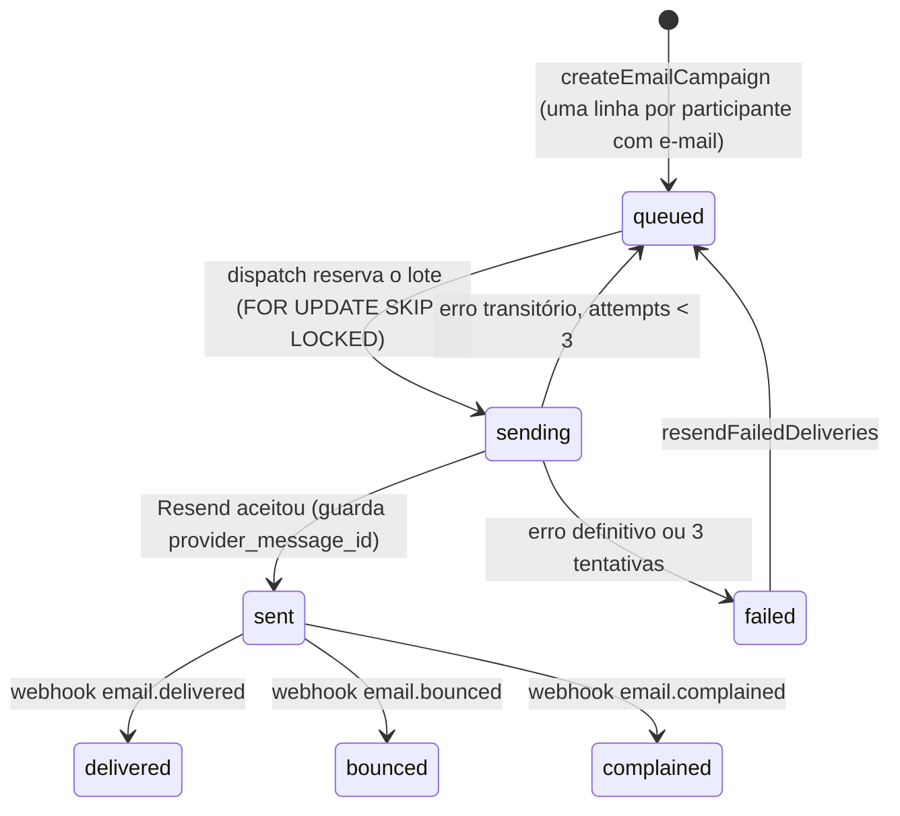

# 10 · Observabilidade

Princípio herdado: **todo dado de observabilidade nasce no Postgres.** O dashboard do admin lê tabelas e views do próprio banco, sem ferramenta externa. Princípio próprio deste projeto: **nenhum log, métrica ou evento carrega dado pessoal.** Nem nome, nem e-mail, nem CPF, nem o valor que alguém digitou em uma busca.

## Métricas de produto do PRD e de onde vêm

### Indicadores rápidos (duas semanas após o evento)

| Métrica | Definição exata | Fonte | Meta |
|---|---|---|---|
| Taxa de retirada | certificados `active` com `first_downloaded_at is not null` ÷ certificados `active` com `issued_at is not null`, por evento | `certificates` (view `v_event_summary`) | ≥ 60% em 7 dias |
| Tempo até o download | mediana de (`certificate_downloads.occurred_at` do primeiro download daquele `device_hash` no dia) menos (`event_visits.first_seen_at` do mesmo `device_hash`, evento e dia) | `event_visits` × `certificate_downloads` | < 90 s |
| Busca sem resultado | tentativas com desfecho `not_found` ou `ambiguous` ÷ tentativas com desfecho diferente de `rate_limited` | `search_attempts` | < 15% |
| Pedidos de correção | pedidos distintos por certificado ÷ certificados emitidos | `name_correction_requests` | < 5% |
| Erro na geração | `pdf_failures` ÷ (`downloads` + `pdf_failures`) | `event_stats_daily` | **0** |

Como o "tempo até o download" é medido sem rastrear ninguém: a página do evento dispara `navigator.sendBeacon('/api/eventos/{slug}/visita')`; o servidor grava `event_visits(event_id, device_hash, day, first_seen_at)` com `on conflict do nothing`. O `device_hash` é o HMAC **diário** do cookie de dispositivo ([doc 08](08-seguranca-e-lgpd.md)): liga a visita ao download dentro do mesmo dia e morre à meia-noite UTC. O download grava o mesmo hash. É uma mediana por evento, não um histórico por pessoa.

`ambiguous` aparece separado no dashboard: uma taxa alta significa homônimos, e a ação é habilitar a data de nascimento como segundo fator ou orientar a busca por CPF.

### Indicadores lentos

| Métrica | Como coletar |
|---|---|
| Trabalho manual do admin por evento (< 15 min) | `import_batches.created_at` do primeiro lote até `events.certificates_released_at`. Aproximação honesta do intervalo "CSV pronto → certificados no ar". |
| Mensagens de suporte sobre certificado (queda de 80%) | fora da plataforma; o substituto observável é o volume de pedidos de correção mais a taxa de busca sem resultado |
| Tempo para cadastrar um novo evento (< 20 min) | `events.created_at` até a publicação do primeiro modelo daquele evento (`certificate_templates.published_at`) |
| Validações externas (≥ 1 por 20 certificados) | `validation_checks` com desfecho `valid` ÷ certificados emitidos, por evento |

## Agregação

`rollup_event_stats(day)` roda às 03:30 UTC e consolida o dia anterior em `event_stats_daily` (`visits`, `searches`, `searches_not_found`, `first_downloads`, `downloads`, `validations`, `correction_requests`, `pdf_failures`). Os logs crus (`search_attempts`, `validation_checks`, `event_visits`) são podados após 90 dias, **só depois de agregados**. `certificate_downloads` fica: é o histórico de retirada que a exportação usa.

O dia de evento é lido ao vivo (consulta direta aos logs do dia corrente, que são pequenos); o histórico vem do agregado.

## Dashboard administrativo (R14, M12)

Na fase 1 existe só o essencial, na página do evento no admin: participantes, certificados, emitidos, retirados, pedidos de correção pendentes. Vem da view `v_event_summary`, custa uma consulta.

No M12, `/admin` e `/admin/eventos/[id]`:

| Widget | Fonte |
|---|---|
| Emitidos, retirados, taxa de retirada | `v_event_summary` |
| Retiradas ao longo do tempo (linha, por hora no dia do evento, por dia depois) | `certificate_downloads` e `event_stats_daily` |
| Quem ainda não baixou, com exportação | `v_pending_downloads` |
| Buscas: total, sem resultado, ambíguas, bloqueadas por limite | `search_attempts` e `event_stats_daily` |
| Tempo até o download (mediana, p90) | `event_visits` × `certificate_downloads` |
| Pedidos de correção pendentes (link para a fila) | `name_correction_requests` |
| E-mails: na fila, enviados, entregues, bounces | `email_deliveries` |
| Validações por desfecho | `validation_checks` |
| Falhas de PDF (destaque em vermelho se > 0) | `event_stats_daily.pdf_failures` |
| Agregado: eventos por status, certificados totais, retirada média | `v_admin_overview` |
| Saúde: último smoke test, último rollup, cota de e-mail do dia e do mês | `cron.job_run_details`, contagem de `email_deliveries` |

Gráficos com `recharts`, cores só dos tokens do design system.

## Fila de e-mail (P1): observável por construção

A fila é a tabela `email_deliveries`. Não há estado escondido em memória.

O `pg_cron` chama `POST /api/internal/email/dispatch` a cada 10 minutos. O handler:

1. Calcula a cota restante: `EMAIL_DAILY_LIMIT` menos os enviados hoje, e `EMAIL_MONTHLY_LIMIT` menos os enviados no mês. Sem cota, sai sem erro.
2. Reserva até `min(cota, 50)` linhas `queued` com `scheduled_for <= now()`.
3. Para cada uma, gera o token de acesso (grava só o hash), monta o e-mail com o link `/certificado/{token}` e envia em lote pela API do Resend, respeitando 2 requisições por segundo.
4. Atualiza os status. Nunca envia para quem tem certificado revogado, nem duas vezes na mesma campanha (unique `(campaign_id, participant_id)`).

Com o teto padrão de 90 por dia, um evento de 250 pessoas leva 3 dias, e a tela da campanha diz isso **antes** do disparo ("250 destinatários, cerca de 3 dias no plano atual"). O teto é configuração: com plano pago, basta subir a env. O PDF não vai anexado. A notificação de pedido de correção (fase 1) sai direto, fora da fila, dentro dos 10 envios diários reservados.

## Logs

Logs estruturados em JSON no stdout (coletados pela Vercel), por um `logger` mínimo em `lib/logger.ts` com níveis `info`, `warn`, `error` e uma **lista branca de campos**: `event`, `route`, `code`, `status`, `duration_ms`, `event_id`, `template_id`, `certificate_id`, `batch_id`, `actor_id`, `outcome`. Qualquer outro campo é descartado pelo logger, o que torna impossível logar um nome por descuido. IDs internos em log são aceitáveis: não são dado pessoal por si e nunca saem em resposta pública.

Eventos que sempre são logados: `pdf.generated` (com `duration_ms` e tamanho), `pdf.failed`, `search.rate_limited`, `import.staged`, `import.applied`, `import.failed`, `template.published`, `email.dispatch`, `correction.requested`, `lgpd.erased`.

## Erros

Sentry opcional por env, configurado como no CF Jobs, com três travas de privacidade: `sendDefaultPii: false`; `beforeSend` remove corpo de requisição, cookies e query string; breadcrumbs de `fetch` para `/api/certificados/*` sem corpo. Falha de geração de PDF é reportada com `certificate_id` e `template_id`, que bastam para reproduzir.

Alertas (por e-mail, do próprio Sentry e do GitHub): qualquer `pdf.failed`; falha do smoke diário (abre issue, [doc 12](12-open-source-e-governanca.md)); falha de job do `pg_cron` (o widget de saúde mostra; sem alerta ativo na fase 1).

## Auditoria

`audit_logs` registra toda mutação do admin (autor, ação `entidade.acao`, entidade, id, diff), escrita pelo esqueleto `defineAction` na mesma transação da operação. Tela `/admin/auditoria` (M12) com filtro por evento, ator e ação. Retenção de 5 anos; o `diff` de uma pessoa é apagado na eliminação LGPD.

## Tráfego

`@vercel/analytics` para visão de páginas, sem cookies. Nenhum outro rastreador. O que é medido e por quê está descrito em `/privacidade`.
