# 13 · Roadmap

As fases são as do PRD. Os milestones (M0 a M12) são a unidade de execução do [doc 14](14-prompt-de-execucao-opus-5.md). **O único prazo duro do projeto é a data em que os certificados do Ferpa Tech Day forem prometidos.** Por isso a produção (M9) vem imediatamente depois da fase 1 funcional, e tudo o que é conforto vem depois dela.

## Visão geral

```mermaid
flowchart LR
    subgraph F1["Fase 1: o primeiro evento precisa disto"]
        M0[M0 Fundação] --> M1[M1 Banco] --> M2[M2 Auth] --> M3[M3 Área pública] --> M4[M4 Admin de eventos]
        M4 --> M5[M5 Motor de certificado] --> M6[M6 Modelos por formulário] --> M7[M7 Importação CSV] --> M8[M8 Busca, retirada, validação] --> M9[M9 Produção]
    end
    subgraph F2["Fase 2: o que o primeiro evento prova que falta"]
        M10[M10 Arrastar no editor] --> M11[M11 E-mail, fila de correção, meus certificados, clonar]
    end
    subgraph F3["Fase 3: operação madura"]
        M12[M12 Dashboard, exportações, LinkedIn]
    end
    M9 --> M10
    M11 --> M12
```

### Duas mudanças em relação à sequência esboçada no pedido de arquitetura, e o porquê

1. **O motor de certificado (M5) vem antes do editor de modelos (M6).** O esboço punha "campos por formulário com prévia ao vivo" antes do "motor de PDF". Só que a prévia ao vivo **é** o motor: `layout()` mais o desenhista SVG. Construir o editor primeiro obrigaria a escrever uma prévia descartável. Com o motor pronto e testado contra modelos em JSON, o editor do M6 vira um formulário que edita JSON e mostra o resultado. A exigência do mantenedor está preservada e reforçada: motor (M5) e CSV (M7) continuam **antes** da busca (M8), porque são o risco real.
2. **Produção é o M9, não o último milestone.** O esboço deixava produção para o fim, depois de e-mail, dashboard e LinkedIn. O prazo do evento não espera a fase 3. Com produção no M9, o sistema está no ar com tudo o que o Ferpa Tech Day precisa, e M10 a M12 são entregues em produção, por PR.

## Fase 1

| Milestone | Entrega | Critério de pronto |
|---|---|---|
| **M0 Fundação** | repo, Next 16, TS strict, Tailwind v4 com os tokens, lint, testes, CI, env, governança, projeto na Vercel para Previews | `pnpm dev` mostra a página com header, footer, tema escuro e alternador; CI verde; Preview no ar |
| **M1 Banco** | migrations 0001 a 0013 com RLS junto de cada tabela, schema Drizzle, seeds, pgTAP | `supabase db reset` do zero, seed e pgTAP verdes no CI; `check:schema` verde |
| **M2 Auth e papéis** | Supabase Auth, claim de papel, proxy, guard do admin, login | E05 |
| **M3 Área pública** | catálogo, página do evento com os 7 estados, capa gerada, SEO, JSON-LD, sitemap, tema, `/privacidade`, `/validar` (só o formulário), cookie de dispositivo no proxy | E01 a E04; Lighthouse dentro do orçamento; build sem banco verde, com a Preview mostrando o catálogo vazio ([ADR-0014](adr/0014-site-vazio-quando-nao-ha-banco.md)) |
| **M4 Admin de eventos** | CRUD de eventos e de tipos de participação, configuração de busca, upload de capa, `defineAction` com auditoria | E06 |
| **M5 Motor de certificado** | `features/certificate` completo, TDD: schema, tokens, formatação, código, fontes e cobertura, ajuste de texto, plano, desenhistas PDF e SVG, QR, `base-pdf`, ETag | matriz PDF-01 a PDF-24 verde; gate `test:gate:pdf` no CI; **um PDF gerado em uma Preview da Vercel** pela rota de desenvolvimento |
| **M6 Modelos, parte 1** | upload da arte com `base.pdf` e fundo da prévia, fontes do admin, declaração de `data_fields`, `layout_fields` por formulário numérico, prévia SVG ao vivo no navegador, "nome mais longo", publicar com as 7 regras | E07; trocar a arte de 150 para 300 dpi não move nenhum campo |
| **M7 Importação CSV** | `features/import` (TDD), assistente de 4 passos, staging, `compute_import_diff`, `apply_import`, preset no modelo, lista de participantes com filtro por lote, edição manual, `removeCertificates` | E08 a E10, E20; CSV-I1 a CSV-I9; gate `test:gate:csv` |
| **M8 Busca, retirada e validação** | `public-lookup`, rate limit de dois baldes, busca, cookie de retirada, tela de retirada com prévia, download com ETag, pedido de correção com notificação, `/validar/[codigo]`, revogar e restaurar (ação simples na lista), `releaseCertificates`, aviso de navegador embutido | E11 a E19, E21 a E23; revisão manual com leitor de tela |
| **M9 Produção** | projeto Supabase (`sa-east-1`, Data API desligada) e Vercel (`gru1`, Node 24.x), domínio, envs, seed do sentinela, smoke diário, Release Please, runbook (com a pendência da eliminação LGPD feita à mão no console, registrada no [doc 08](08-seguranca-e-lgpd.md#direitos-do-titular-e-o-que-fazer-quando-alguém-pede-remoção)), verificações manuais do [doc 11](11-qualidade.md) | um evento real de ponta a ponta em produção; teste de carga aprovado; alguém da organização que não é dev cadastrou um evento sozinho, **ensaiado em produção**: a Preview não tem banco nem Supabase e mostra o site vazio ([ADR-0014](adr/0014-site-vazio-quando-nao-ha-banco.md)). O runbook confere que a Vercel expõe `VERCEL_ENV`, de que depende a guarda do build de produção. |

**Pronto da fase 1:** os critérios de aceite de R1 a R9 do PRD, com as divergências aprovadas ([doc 00](00-visao-geral.md)), verificados pelos E2E citados.

**Se o prazo apertar**, a ordem de corte dentro da fase 1 é, do primeiro ao último a sair: fontes enviadas pelo admin (ficam só as curadas); modo "vários tipos" da importação (fica um CSV por tipo); segunda página do modelo; capa gerada (cai para uma imagem estática da comunidade). Nada além disso sai: busca, PDF correto, importação idempotente, validação e rate limit são o produto.

## Fase 2

| Milestone | Entrega | Critério de pronto |
|---|---|---|
| **M10 Modelos, parte 2** | arrastar e redimensionar sobre a prévia com Pointer Events, alças, teclado, guias de alinhamento ao centro e às bordas. **A estrutura de dados não muda.** | E24; o formulário numérico continua funcionando e continua sendo o caminho acessível |
| **M11 Fase 2 do PRD** | R10 e-mail em massa (campanha, fila, despacho por `pg_cron`, webhook, painel, reenvio dos que falharam), tokens de acesso direto, R11 fila de correção, R12 revogação completa (link direto deixa de funcionar), R13 meus certificados, `cloneEvent`, disjuntor de rate limit por evento | E25 a E27; SPF e DKIM conferidos antes do primeiro envio; uma campanha real entregue respeitando o teto diário |

## Fase 3

| Milestone | Entrega | Critério de pronto |
|---|---|---|
| **M12 Operação madura** | R14 dashboard completo e widget de saúde, tela de auditoria, R15 exportações XLSX e relatório em PDF, R16 LinkedIn (formato conferido na documentação vigente) | E28; as métricas do PRD visíveis com dados reais de um evento |

## P2: a arquitetura permite, ninguém constrói agora

| Item do PRD | Onde encaixa |
|---|---|
| Cache do PDF gerado no Storage | objeto `generated/{certificate_id}/{etag}.pdf`; o ETag já é a chave de invalidação ([doc 05](05-motor-de-certificados.md)) |
| Check-in alimentando a presença | nova origem de `import_rows`; o resto do pipeline é o mesmo |
| Percentual mínimo de presença | regra antes do staging |
| Página pública por participante | exige consentimento e identidade entre eventos, que hoje não existe de propósito (salt por evento). Decisão própria, com ADR e revisão de LGPD. |
| Outras comunidades na mesma instância | reescrita de RLS; v2 |
| Internacionalização | sem demanda |
| CPF completo impresso | coluna `cpf_encrypted`, ADR próprio ([doc 08](08-seguranca-e-lgpd.md)) |

## Riscos e mitigação

| Risco | Mitigação no plano |
|---|---|
| O editor consome a fase 1 | formulário numérico no M6, arrastar só no M10; o motor não sabe a diferença |
| Acento quebrado em produção | gate `test:gate:pdf` por fonte e peso, desde o M5 |
| Fontes somem no deploy | M5 só fecha com PDF gerado em Preview da Vercel |
| CSV do Excel vira `ç` | decodificação determinística e gate `test:gate:csv`; a inspeção mostra as linhas já decodificadas |
| Auditório bloqueado pelo rate limit | dois baldes, cookie na primeira visita, teste E13 com dois dispositivos no mesmo IP |
| Supabase pausa e a validação cai | smoke diário que toca o Postgres |
| `CPF_PEPPER` perdido | guardado por dois admins, no runbook do M9; nunca rotacionado |
| Plano gratuito do Resend | fila com teto; e-mail é fase 2 e nunca é o caminho principal |
| Ninguém além do mantenedor opera | verificação manual 3 do doc 11 é critério de pronto do M9 |
| A planilha real chega tarde | fixtures sintéticas cobrem os formatos; a real vira fixture anonimizada quando chegar, sem mudança de código |
| Free tiers mudarem | nada proprietário além do Supabase Auth; Postgres, Storage compatível com S3 e Next portáveis |
